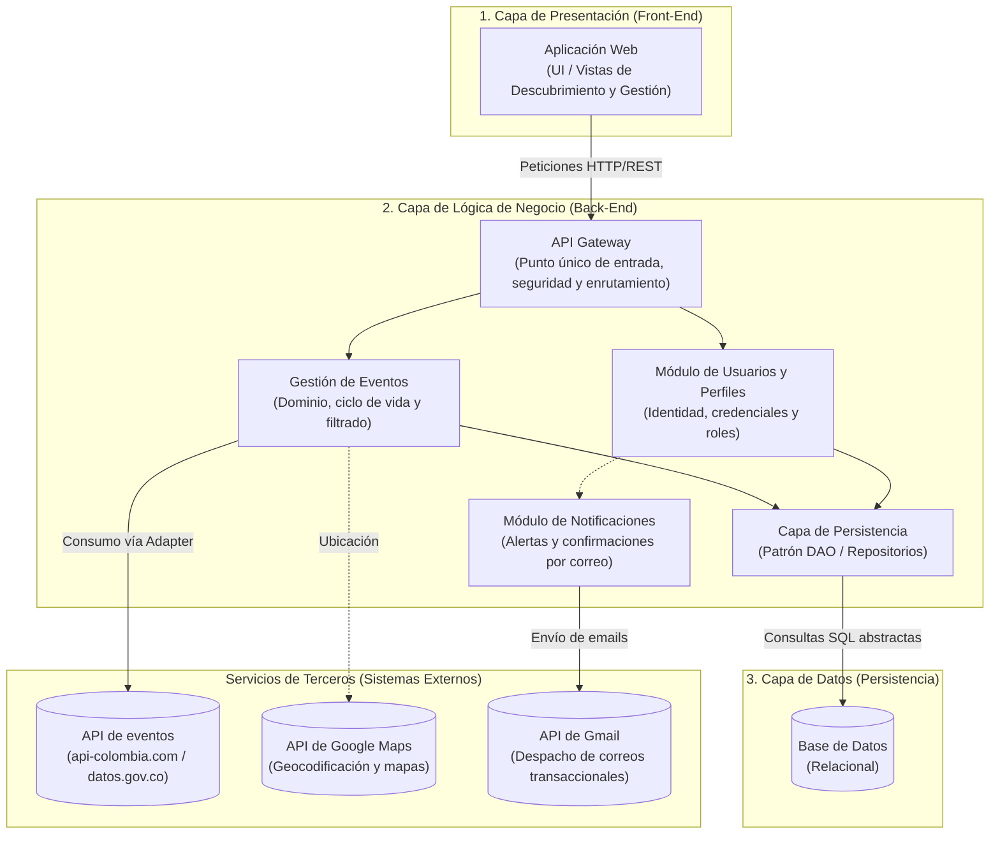

# ADR-0005: Arquitectura por Capas
<!-- docs/adr/0005-arquitectura-por-capas.md -->

## Autores:

- Justin David Vargas Vasquez
- Cristian Andrés Díaz Ortega

## Contexto
El proyecto se encuentra en su fase inicial de concepción, estructuración y validación del Producto Mínimo Viable (MVP). La plataforma aborda dos grandes responsabilidades funcionales: la gestión del ciclo de vida de eventos por parte de organizadores (`REQ-02`), la consulta y filtrado multidimensional de actividades (`REQ-01`) y el control de acceso e identidad de los usuarios (`REQ-13`). 

Para guiar la construcción del sistema sin dispersión técnica ni sobrecostos de infraestructura, el equipo diseñó el diagrama delimitador de arquitectura **`Arquitectura_de_Software_en_Capas_3.drawio`** (ubicado en `Docs/Arquitectura en capas/`). Se requería tomar una decisión formal sobre cómo estructurar las capas del sistema, los límites de responsabilidad de sus módulos internos y su interacción con los servicios externos de terceros.

Adoptar arquitecturas distribuidas (como microservicios) en una etapa temprana incrementaría drásticamente los costos operativos, la complejidad de observabilidad y el riesgo de inconsistencias transaccionales, sin aportar beneficios medibles en un producto en fase de validación inicial.

## Decisión

Se adopta formalmente una **Arquitectura en 3 Capas bajo el patrón de Monolito Modular**, organizada en estricta fidelidad con el diagrama `Arquitectura_de_Software_en_Capas_3.drawio`. El sistema divide sus responsabilidades en tres capas lógicas principales y una frontera de integración con servicios externos:

### Componentes y Responsabilidades de la Arquitectura

#### 1. Capa de Presentación (Front-End)
* **Aplicación Web:** Es la interfaz de usuario final (desarrollada con React, TypeScript y Vite conforme al ADR-0001). Se encarga de capturar las acciones del usuario (ingreso de filtros de presupuesto, horario y zona geográfica, así como creación de eventos y registro) y comunicarse **exclusivamente con el API Gateway** del Back-End mediante peticiones HTTP/REST estandarizadas.

#### 2. Capa de Lógica de Negocio (Back-End)
Es el núcleo del sistema, desarrollado como una aplicación modular (NestJS / TypeScript conforme al ADR-0002). Alberga los siguientes módulos:
* **API Gateway:** Punto único de entrada al Back-End. Enruta las solicitudes provenientes del Front-End hacia los módulos de negocio correspondientes, gestiona la validación inicial de esquemas de datos y verifica la autenticación/autorización mediante tokens.
* **Módulo de Usuarios y Perfiles:** Gestiona la identidad en la plataforma: registro de nuevos usuarios (`REQ-13`), inicio de sesión, asignación de roles (asistente / organizador), permisos y datos del perfil.
* **Gestión de Eventos:** Encapsula la lógica central del negocio: creación, edición y cancelación de eventos locales (`REQ-02`), y la orquestación del filtrado y consulta multidimensional (`REQ-01`), aplicando las reglas de aforo (BR-01) y tarifas (BR-02).
* **Módulo de Notificaciones:** Responsable de orquestar el despacho de mensajes y correos electrónicos hacia los usuarios. En la Primera Etapa, gestiona la confirmación de registro de usuarios (`REQ-13`) mediante la API de Gmail; en fases posteriores, despachará recordatorios y alertas de eventos modificados (`REQ-12`).
* **Capa de Persistencia:** Actúa como intermediario desacoplado entre los módulos de negocio y la base de datos física. Implementa el patrón DAO (Data Access Object) y Repositorio para abstraer las operaciones de acceso a datos y evitar que la lógica de negocio dependa directamente del motor relacional SQL.

#### 3. Capa de Datos (Persistencia)
* **Base de Datos:** Almacenamiento físico y centralizado de la información. Recibe consultas y escrituras exclusivamente a través de la Capa de Persistencia del Back-End.

#### 4. Frontera de Integración con Servicios de Terceros
APIs externas ubicadas fuera del límite del sistema, consumidas a través de la capa adaptadora (definida en el ADR-0004):
* **API de Eventos:** Integración con `https://api-colombia.com/` (datos territoriales y contexto nacional como museos o parques con caché local) y `https://www.datos.gov.co/.../xm7a-7paj/about_data` (eventos oficiales abiertos).
* **API de Google Maps:** Geocodificación.
* **API de Gmail:** Servicio externo para el despacho de correos electrónicos transaccionales.

---

## Alternativas consideradas

- Microservicios desde el inicio: descartado. Aumento en infraestructura y complejidad operativa (service discovery, tracing distribuido, consistencia eventual, contratos entre servicios) sin valor demostrado en un
  producto no validado. Además, el equipo tendría que aprender simultáneamente el dominio, las tecnologías y la operación distribuida.

- Serverless (Lambda + API Gateway + DynamoDB): cold starts, límites de ejecución y dificultad para transacciones largas (reserva + pago + notificación + webhook al proveedor). Añade un paradigma nuevo al equipo.
  Descartado para el MVP.

- Event-Driven Architecture pura: ideal para escalar, pero exige manejar consistencia eventual, dead letter queues, idempotencia y trazabilidad distribuida. 

- Arquitectura hexagonal / clean architecture completa: valiosa pero con sobrecarga de abstracciones innecesaria para el tamaño actual del equipo.

## Consecuencias

### Positivas:

- **Fidelidad con el diseño del equipo:** Representa con total exactitud la delimitación gráfica aprobada en `Arquitectura_de_Software_en_Capas_3.drawio`.

- **Desacoplamiento modular:** Las capas y módulos mantienen fronteras claras. La lógica de negocio no contiene sentencias SQL directas (aisladas en la Capa de Persistencia) ni llamadas HTTP directas sin adaptador (aisladas en Integración de APIs).

- **Velocidad de entrega del MVP:** El monolito modular se compila, prueba y despliega como un único artefacto, permitiendo ejecutar transacciones ACID locales de manera predecible.

- **Testabilidad unitaria:** La separación por capas permite probar la lógica de dominio de eventos y usuarios sin necesidad de levantar servidores web ni bases de datos físicas.

### Negativas / costos aceptados:

-  **Disciplina en límites de módulos:** Al ejecutarse dentro del mismo proceso de backend, los desarrolladores deben mantener la disciplina de no realizar importaciones cruzadas directas que vulneren las capas.

- **Escalabilidad vertical:** El crecimiento de carga requiere escalar el proceso monolítico completo, lo cual es plenamente aceptable para la demanda proyectada del proyecto de curso. 
