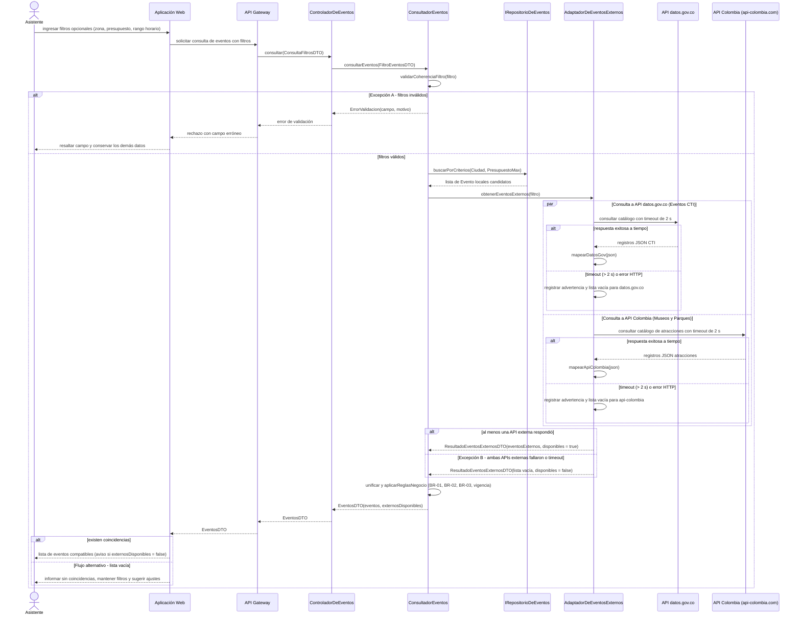
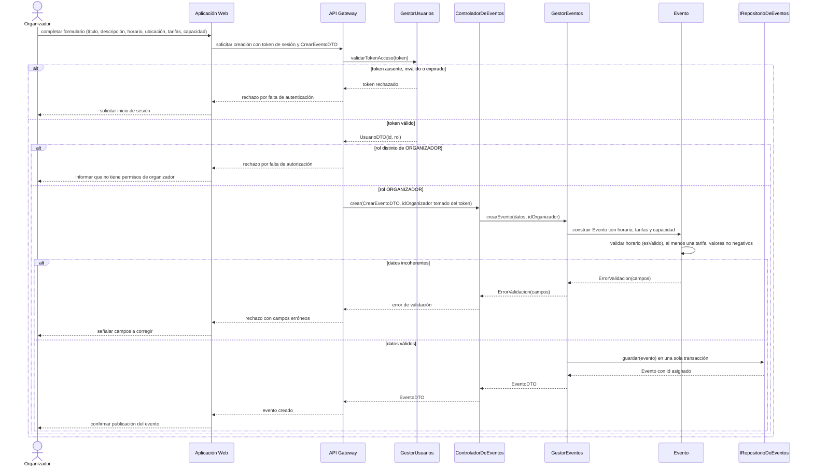
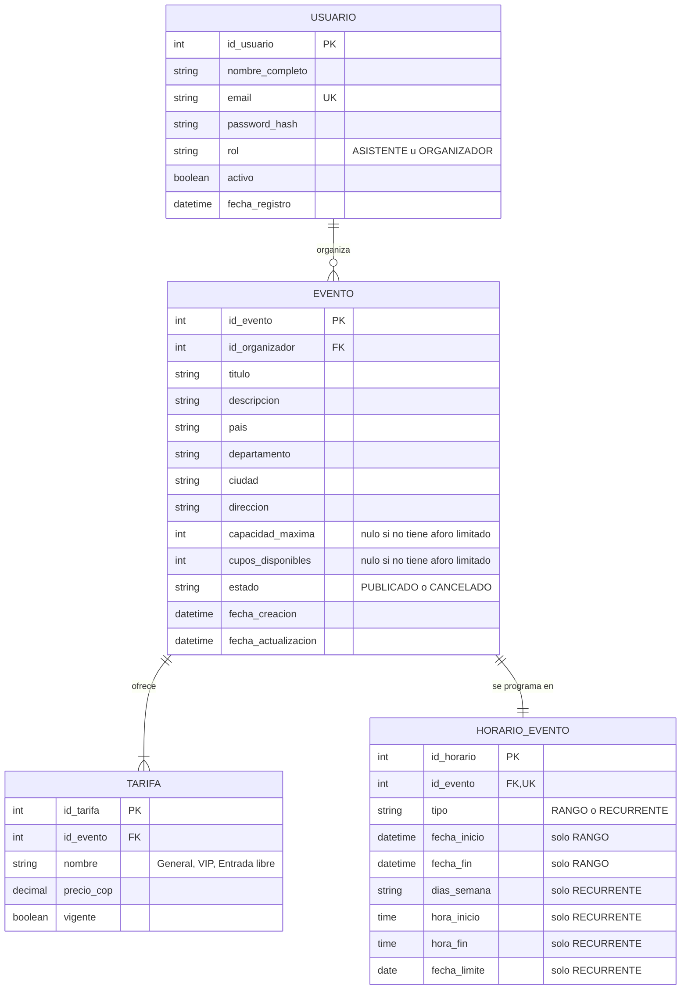

# Plataforma de Descubrimiento y Gestión de Eventos — Interaction & Data Design v1.0

| | |
|---|---|
| **Team** | Power Rangers |
| **Members** | Cristian Andrés Díaz Ortega - Juan Sebastián Rodríguez Carvajal - Martín Lora Caro - Justin David Vargas Vásquez - Nicolás David Lovera Cabiativa |
| **Status** | Listo para revisión |
| **Date** | 23/10/2026 |
| **Inputs** | `Docs/Design/Diseño Arquitectónico detallado 01 (1).md` (Entregable 1 actualizado), Casos de uso y reglas en `Docs/Requirements/` y `Docs/Business Rules/`, Criterios de aceptación, Historias de usuario, ADR-0003 a ADR-0005, Interaction & Contracts Design v0.1 (Clase 13) |

> **Convenciones de este documento.** Para separar lo aprobado de lo propuesto se usan cuatro etiquetas:
> **[APROBADO]** requisito o regla ya validada en `Docs/` · **[DECISIÓN PROPUESTA]** decisión de diseño de este entregable, sujeta a revisión · **[SUPUESTO]** condición que se asume para poder diseñar y que debe confirmarse · **[PREGUNTA ABIERTA]** asunto no resuelto, registrado en la Sección 5 con su identificador `OQ-xx`.
>

---

## 1. Behavior — Selected Use Cases (Comportamiento — Casos de uso seleccionados)

Se seleccionan dos casos de uso de la Primera Etapa con interacción significativa entre componentes:

| # | Caso de uso | Requerimiento | Motivo de selección |
|---|---|---|---|
| 1.1 | Consultar y Filtrar Eventos | `REQ-01` (capstone) | Núcleo de valor del sistema; involucra 5 componentes, dos sistemas externos de eventos y tres flujos no felices (Excepción A, Excepción B, flujo alternativo). |
| 1.2 | Administrar Eventos — Crear Evento | `REQ-02` / `US-02.1` | Única operación de la Etapa 1 que **modifica** el catálogo; obliga a hacer concreta la autorización (identidad y rol) y la persistencia transaccional del evento con sus tarifas y horario. |

### 1.1 Consultar y Filtrar Eventos — from requirement REQ-01

**[APROBADO]** Fuente: caso de uso de `REQ-01.md` §4.3 (flujo principal pasos 1–6, flujo alternativo, Excepción A, Excepción B), reglas BR-01, BR-02, BR-03, ADR-0004 (timeout de 2 s y fallback en tiempo real) y `Diseño Arquitectónico detallado 01 (1).md` (adaptador unificado `AdaptadorDeEventosExternos` para consulta de eventos en `datos.gov.co` y `api-colombia.com`, sin normalización geográfica ni caché local).

**Notas de diseño del diagrama**

- **[SUPUESTO]** `REQ-01` admite como actor a un usuario registrado **o invitado**; por eso el API Gateway enruta la consulta sin exigir token. Si la consulta requiriera sesión, se añadiría el mismo bloque de validación del diagrama 1.2.
- **[DECISIÓN APROBADA]** Conforme al `Diseño Arquitectónico detallado 01 (1).md`, el componente `AdaptadorDeEventosExternos` unifica la consulta de eventos externos hacia **ambas APIs**: `datos.gov.co` (eventos CTI) y `api-colombia.com` (museos, parques y atracciones culturales tratadas como eventos). **Ambas APIs son fuentes de catálogo de eventos**.
- **[DECISIÓN APROBADA] Sin almacenamiento en caché local:** Las consultas a los proveedores remotos se realizan en tiempo real directo. No se mantiene ningún mecanismo de caché local en memoria ni en disco, asegurando la frescura instantánea de los datos y reduciendo la complejidad del módulo de integración.
- **[DECISIÓN PROPUESTA]** El *timeout* (2 s) y el *fallback* ante errores o demoras de los proveedores externos los absorbe internamente `AdaptadorDeEventosExternos`, no `ConsultadorEventos`. El adaptador retorna `ResultadoEventosExternosDTO` con los eventos obtenidos y la bandera `disponibles`. Esto preserva el ocultamiento de información (la capa de aplicación no manipula errores HTTP) y provee a la UI la bandera necesaria para desplegar el aviso informativo de la Excepción B.
- **[DECISIÓN PROPUESTA]** La decisión de mostrar "sin coincidencias" la toma la Aplicación Web a partir de una lista vacía: para el back-end, una consulta sin resultados es un **éxito**, no una falla.
- BR-01 y BR-02 se aplican en `aplicarReglasNegocio` sobre **todos** los eventos (locales y externos mapeados a dominio). BR-03 se aplica en dos puntos: `buscarPorCriterios` solo filtra por los criterios provistos y `aplicarReglasNegocio` omite los criterios ausentes.

| Use Case step or flow | Message(s) in the diagram | Information exchanged | Operation defined in (Deliverable 1 actualizado) |
|---|---|---|---|
| Flujo principal, pasos 1–2 (ingresar y enviar filtros) | `U->>WEB`, `WEB->>GW`, `GW->>CE` | País, departamento, ciudad, presupuesto máximo, rango horario (todos opcionales) | `ControladorDeEventos.consultar(req: ConsultaFiltrosDTO)` |
| Flujo principal, paso 3 (validar formato y coherencia) | `CE->>CO`, `CO->>CO validarCoherenciaFiltro` | `FiltroEventosDTO` | `ConsultadorEventos.consultarEventos(filtro)` (validación descrita en §3.4) |
| Flujo principal, paso 4 (consultar BD local) | `CO->>REP`, `REP-->>CO` | Criterios opcionales → lista de `Evento` | `IRepositorioDeEventos.buscarPorCriterios(...)` *(firma ajustada, ver Sección 4)* |
| Flujo principal, paso 4 (consultar APIs de eventos externas) | `CO->>EXT`, `EXT->>GOV`, `EXT->>COL`, `EXT-->>CO` | Filtro → `ResultadoEventosExternosDTO` | `IProveedorEventosExternos.obtenerEventosExternos(filtro)` implementado por `AdaptadorDeEventosExternos` |
| Flujo principal, paso 5 (consolidar y aplicar BR-01, BR-02) | `CO->>CO unificar y aplicarReglasNegocio` | Lista unificada de `Evento` | `ConsultadorEventos.aplicarReglasNegocio(eventos, filtro)` |
| Flujo principal, paso 6 (presentar resultados) | `CO-->>CE`, `CE-->>GW`, `GW-->>WEB`, `WEB-->>U` | `EventosDTO` | `ControladorDeEventos.consultar` → `EventosDTO` |
| Flujo alternativo (sin coincidencias) | `alt Flujo alternativo` en `WEB-->>U` | `EventosDTO` con lista vacía | Mismo retorno de `consultarEventos` |
| Excepción A (criterios malformados) | `alt Excepción A` | `ErrorValidacion(campo, motivo)` | `validarCoherenciaFiltro` en `ConsultadorEventos` |
| Excepción B (timeout o indisponibilidad externa) | `alt Excepción B` | `ResultadoEventosExternosDTO(disponible = false)` → `externosDisponibles = false` | `AdaptadorDeEventosExternos.obtenerEventosExternos` (timeout 2 s, fallback y advertencia) |

*Verificación:* cada mensaje tiene propósito y respuesta; el orden respeta el caso de uso (validar → consultar → consolidar → presentar); los tres flujos no felices de `REQ-01` están cubiertos; la Excepción B no bloquea al usuario, cumpliendo la postcondición del caso de uso.

### 1.2 Administrar Eventos (Crear Evento) — from requirement REQ-02

**Notas de diseño del diagrama**

- **[APROBADO]** El API Gateway "valida tokens de sesión y autorización por rol" (Entregable 1, tabla de componentes). Para validar el token usa la capacidad `validarSesion(token)` del Módulo de Usuarios, implementada en `GestorUsuarios.validarTokenAcceso(token)`.
- **[DECISIÓN PROPUESTA]** El `idOrganizador` **siempre** proviene del token validado y nunca del cuerpo de la petición. Así se evita que un usuario cree o modifique eventos a nombre de otro. En el Entregable 1, `ControladorDeEventos.crear(req)` no recibe ese parámetro; el ajuste se registra en la Sección 4.
- **[DECISIÓN PROPUESTA]** La validación de coherencia vive en la entidad `Evento` y en `HorarioEvento.esValido()`, no en el controlador. Así la misma regla protege también a `modificarEvento`.
- **[SUPUESTO]** Una falla de persistencia (base de datos no disponible) no está especificada en `REQ-02`. Se trata en el contrato como falla genérica sin cambios de estado y no se dibuja para no inventar comportamiento de interfaz (ver `OQ-09`).

| Use Case step or flow | Message(s) in the diagram | Information exchanged | Operation defined in (Deliverable 1) |
|---|---|---|---|
| Paso 1 — Organizador ingresa datos del evento (`US-02.1`) | `O->>WEB` | Título, descripción, horario, ubicación, tarifas, capacidad | Aplicación Web — captura de formularios |
| Paso 2 — Enviar solicitud de creación **[SUPUESTO: paso derivado]** | `WEB->>GW` | Token + `CrearEventoDTO` | API Gateway — enrutamiento |
| Paso 3 — Verificar identidad y rol (`REQ-02`: "usuarios autorizados") | `GW->>GU`, `GU-->>GW` | Token → `UsuarioDTO(id, rol)` | `GestorUsuarios.validarTokenAcceso(token)` / capacidad `validarSesion(token)` |
| Paso 4 — Delegar creación | `GW->>CE`, `CE->>GE` | `CrearEventoDTO`, `idOrganizador` | `ControladorDeEventos.crear(...)`, `GestorEventos.crearEvento(datos, idOrganizador)` |
| Paso 5 — Validar coherencia de horario, tarifas y capacidad (`REQ-02`) | `GE->>EV`, `EV->>EV` | Datos del evento | `Evento` (constructor / `actualizar`), `HorarioEvento.esValido()` |
| Paso 6 — Persistir evento | `GE->>REP`, `REP-->>GE` | `Evento` → `Evento` con id | `IRepositorioDeEventos.guardar(evento)` |
| Paso 7 — Confirmar publicación **[SUPUESTO: paso derivado]** | `GE-->>CE` … `WEB-->>O` | `EventoDTO` | `ControladorDeEventos.crear` → `EventoDTO` |
| Excepción — token inválido **[SUPUESTO: derivada de la responsabilidad del Gateway]** | `alt token ausente, inválido o expirado` | Rechazo de autenticación | API Gateway / `validarTokenAcceso` |
| Excepción — rol no organizador | `alt rol distinto de ORGANIZADOR` | Rechazo de autorización | API Gateway (autorización por rol), `Usuario.esOrganizador()` |
| Excepción — datos incoherentes | `alt datos incoherentes` | `ErrorValidacion(campos)` | `Evento` / `HorarioEvento.esValido()` |

---

## 2. Data Design (Diseño de datos)

### 2.1 Principal information the system needs (Información principal)

| Information | Needed by (use cases) | Persisted? | Why (or why not) |
|---|---|---|---|
| **Usuario** (identificación, email, hash de contraseña, rol, estado) | Registrar/Autenticar (`REQ-13`), Crear Evento (`REQ-02`, autorización) | **Sí** | Es propiedad del sistema y debe sobrevivir entre sesiones; el email único y el rol son la base de la autorización. |
| **Evento local** (título, descripción, ubicación, capacidad, cupos, estado, organizador) | Consultar (`REQ-01`), Crear/Modificar/Eliminar (`REQ-02`) | **Sí** | El sistema es el dueño autoritativo de los eventos creados por organizadores. |
| **Tarifas del evento** (nombre, precio, vigencia) | Consultar (`REQ-01`, BR-02), Crear (`REQ-02`) | **Sí** | BR-02 trabaja sobre *múltiples* tarifas vigentes; `US-02.1` exige registrar los "productos ofrecidos". |
| **Horario del evento** (rango continuo o recurrente) | Consultar (`REQ-01`, filtro horario), Crear (`REQ-02`) | **Sí** | Es parte del estado del evento; el Entregable 1 lo modela como `HorarioRango` / `HorarioRecurrente`. |
| **Eventos externos** (`datos.gov.co` y `api-colombia.com`) | Consultar (`REQ-01`) | **No** **[DECISIÓN APROBADA]** | Su dueño son los proveedores externos y el sistema no controla su ciclo de vida (Restricción 1 de `REQ-01`). Persistirlos crearía copias desactualizadas. Se consultan en tiempo real vía `AdaptadorDeEventosExternos` con timeout de 2 s, sin implementar almacenamiento en caché local. |
| **Zonas y ubicaciones geográficas** | Consultar (`REQ-01`) | **No** **[DECISIÓN APROBADA]** | No se cuenta ni se requiere un catálogo de normalización geográfica externa. Los filtros de país, departamento y ciudad se contrastan directamente contra los atributos textuales de ubicación de los eventos locales y remotos. |
| **Filtros de búsqueda y resultados** | Consultar (`REQ-01`) | **No** | Son transitorios por petición; ningún requerimiento de la Etapa 1 pide historial de búsquedas. |
| **Token de sesión** | Autenticar (`REQ-13`), Crear Evento (`REQ-02`) | **No** **[SUPUESTO]** | Se asume un token autocontenido y firmado (JWT, Entregable 1 `IProveedorDeToken`). Si se exigiera revocación o cierre de sesión forzado, habría que persistir una lista de revocación (`OQ-10`). |
| **Correo de confirmación enviado** | Registrar (`REQ-13`) | **No** | Lo despacha y conserva la API de Gmail; ningún requerimiento pide auditoría de envíos. |
| **Reportes de eventos sospechosos** | Mitigación de riesgo de `REQ-01` | **No en esta etapa** | El README lo programa para el Incremento 2; no se diseña aquí para no adelantar alcance. |

### 2.2 Data model (Modelo de datos)

**Representación elegida: Opción A — Relacional.**
> Los datos de la Etapa 1 son entidades fuertemente relacionadas (usuario → evento → tarifas/horario), con restricciones de integridad (email único, FK de organizador, valores no negativos), y la creación de un evento con sus tarifas y horario debe ser **atómica**. Esto encaja con un modelo relacional ACID, coherente con ADR-0003 y ADR-0005.

| Entity / document type | Meaning in the system | Identifier | Constraints (required, unique, allowed values) |
|---|---|---|---|
| `USUARIO` | Persona registrada que consulta eventos (asistente) o los administra (organizador). | `id_usuario` | `email` obligatorio y **único**; `password_hash` obligatorio (nunca se guarda la contraseña plana); `rol ∈ {ASISTENTE, ORGANIZADOR}`; `activo` obligatorio. |
| `EVENTO` | Evento local publicado por un organizador; el sistema es su dueño autoritativo. | `id_evento` | `id_organizador` obligatorio (FK a `USUARIO` con rol ORGANIZADOR, validado en lógica); `titulo` y `ciudad` obligatorios; `capacidad_maxima` nula o `> 0`; `cupos_disponibles` nulo o `0 ≤ cupos ≤ capacidad_maxima`, y ambos nulos o ambos no nulos; `estado ∈ {PUBLICADO, CANCELADO}`. |
| `TARIFA` | Tipo de entrada o localidad con su precio en COP. | `id_tarifa` | `id_evento` obligatorio; `precio_cop ≥ 0` (0 = entrada libre, AC.1.3); `nombre` único dentro del mismo evento; cada evento tiene **al menos una** tarifa (regla aplicada en lógica, ver 2.4). |
| `HORARIO_EVENTO` | Programación temporal del evento: rango continuo o recurrencia semanal. | `id_horario` | `id_evento` obligatorio y único (1:1); `tipo ∈ {RANGO, RECURRENTE}`; si `RANGO`: `fecha_inicio` y `fecha_fin` obligatorias con `fecha_fin > fecha_inicio`; si `RECURRENTE`: `dias_semana`, `hora_inicio`, `hora_fin`, `fecha_limite` obligatorios. |

**Decisiones del modelo**

| Decisión | Alternativas consideradas | Por qué se elige / trade-off aceptado |
|---|---|---|
| **[DECISIÓN PROPUESTA] D-DAT-1 — Entidad `TARIFA` separada** en lugar de las columnas `tarifaMinima` / `tarifaMaxima` del Entregable 1. | (a) Mantener solo `tarifaMinima` y `tarifaMaxima` en `Evento`. (b) Guardar las tarifas en un campo JSONB. | BR-02 equivale a "la menor tarifa **vigente** ≤ presupuesto", así que (a) basta para filtrar, pero pierde las tarifas intermedias, la vigencia por tarifa y los "productos ofrecidos" de `US-02.1`. (b) impide restricciones de integridad (`precio ≥ 0`). Se acepta un *join* adicional en la consulta; `tarifaMinimaVigente()` pasa a ser un valor **derivado**, no almacenado, para evitar inconsistencias. |
| **[DECISIÓN PROPUESTA] D-DAT-2 — Horario en una sola tabla con discriminador `tipo`.** | (a) Una tabla por subclase (`HORARIO_RANGO`, `HORARIO_RECURRENTE`). (b) JSONB (mencionado en ADR-0003 y en la Decisión B del Entregable 1). | Refleja el polimorfismo `HorarioEvento` con una sola relación 1:1 y permite `CHECK` por tipo. (a) añade *joins* y complejidad de mapeo sin beneficio para dos variantes. (b) no permite validar coherencia en la base de datos. Se aceptan columnas nulas según el tipo. Debe documentarse en el ADR-0006 pendiente. |
| **[DECISIÓN APROBADA] D-DAT-3 — Ubicación como atributos de texto en `Evento` sin normalización externa.** | Crear tablas maestras `DEPARTAMENTO` / `CIUDAD` o validar contra APIs externas geográficas. | Ambas APIs externas (`datos.gov.co` y `api-colombia.com`) son fuentes de catálogo de eventos; no se requiere normalización geográfica externa. Mantener los atributos directamente en `Evento` evita acoplamiento innecesario y reduce la latencia en las consultas. |
| **[DECISIÓN PROPUESTA] D-DAT-4 — Aforo opcional** (`capacidad_maxima` y `cupos_disponibles` nulos = sin aforo limitado). | Usar un valor centinela (ej. `-1` o un número muy grande). | BR-01 aplica solo "para eventos con aforo o boletería limitada"; el valor nulo expresa esa condición sin números mágicos. Quién decrementa `cupos_disponibles` en la Etapa 1 queda abierto (`OQ-05`). |
| **[DECISIÓN PROPUESTA] D-DAT-5 — Cancelación lógica** (`estado = CANCELADO`) en vez de borrado físico. | Borrado físico (`DELETE`). | `US-02.3` habla de "cancelarlo formalmente" y el Entregable 1 ya define `Evento.cancelar()`; conservar el registro habilita `REQ-12` en fases posteriores. Se acepta que las consultas filtren siempre por estado. **Requiere confirmación** (`OQ-04`). |

### 2.3 Data Ownership (Propiedad de los datos)

| Information | Authoritative owner (component responsible for maintaining it) | Consumed by (uses it without owning it) | Access through |
|---|---|---|---|
| Usuario (credenciales, rol, estado) | **Módulo de Usuarios y Perfiles** (`GestorUsuarios`) | API Gateway (identidad y rol para autorizar); Gestión de Eventos (solo el `idOrganizador` recibido del Gateway) | `GestorUsuarios.validarTokenAcceso(token)` para consumidores; `IRepositorioDeUsuario` solo lo usa el Módulo de Usuarios |
| Evento local, Tarifa, Horario | **Gestión de Eventos** (`GestorEventos` escribe; `ConsultadorEventos` lee) | Aplicación Web (a través del API Gateway) | `ControladorDeEventos` hacia fuera; `IRepositorioDeEventos` solo lo usa Gestión de Eventos |
| Eventos externos | **Sistemas externos `datos.gov.co` y `api-colombia.com`** (fuera de la frontera) | Gestión de Eventos (`ConsultadorEventos`) | `IProveedorEventosExternos` → `AdaptadorDeEventosExternos` (consultas en tiempo real directo) |
| Token de sesión | **Módulo de Usuarios y Perfiles** lo emite (`IProveedorDeToken`); el cliente solo lo porta | API Gateway | `GestorUsuarios.validarTokenAcceso(token)` |

> La **Capa de Persistencia** implementa los repositorios, pero **no es dueña** del significado de los datos: solo traduce entre entidades y tablas. Ningún módulo usa el repositorio de otro módulo (Gestión de Eventos no lee `USUARIO` directamente; para esto recibe el `idOrganizador` ya validado).

### 2.4 Business rules and invariants enforced in data (Reglas e invariantes)

| Business rule or invariant | Where it is enforced (component logic / data constraint / both) | How |
|---|---|---|
| **BR-01** — Solo se muestran eventos con aforo limitado si tienen al menos 1 cupo | **Ambos** | Lógica: `Evento.tieneCupoDisponible()` retorna verdadero si `capacidad_maxima` es nula o `cupos_disponibles ≥ 1`; se aplica en `aplicarReglasNegocio` a eventos locales y externos. Datos: `CHECK (cupos_disponibles >= 0 AND cupos_disponibles <= capacidad_maxima)`. |
| **BR-02** — El evento califica si al menos una tarifa vigente es ≤ presupuesto | **Lógica** (con apoyo en la consulta) | `Evento.tarifaMinimaVigente() <= presupuestoMaximo`; el repositorio puede filtrar con `EXISTS (tarifa vigente con precio ≤ presupuesto)`. Se omite si no hay presupuesto (BR-03). Datos: `CHECK (precio_cop >= 0)`. |
| **BR-03** — Filtros combinables u omitidos; sin filtros, listado general | **Lógica** | `CriteriosBusqueda` con campos opcionales; el repositorio y `aplicarReglasNegocio` ignoran los criterios nulos. Sin filtros se retorna el listado general de eventos vigentes (la estrategia "aleatoria" queda en `OQ-11`). |
| Email único por usuario (`REQ-13`) | **Ambos** | Lógica: `GestorUsuarios` verifica `buscarPorEmail` antes de registrar. Datos: restricción `UNIQUE (email)`, que también protege ante registros simultáneos. |
| Un evento tiene al menos una tarifa y un horario válido antes de publicarse (`REQ-02`, Entregable 1) | **Ambos** | Lógica: `Evento` rechaza la construcción sin tarifas o con `HorarioEvento.esValido() = falso`; `GestorEventos` guarda evento, tarifas y horario en **una sola transacción**. Datos: `HORARIO_EVENTO.id_evento` `NOT NULL UNIQUE`. La condición "≥ 1 tarifa" no es expresable con un `CHECK` simple y depende de la transacción. |
| Fin de horario posterior al inicio | **Ambos** | Lógica: `HorarioRango.esValido()`, `HorarioRecurrente.esValido()`. Datos: `CHECK (tipo <> 'RANGO' OR fecha_fin > fecha_inicio)` y equivalente para `hora_fin > hora_inicio` en `RECURRENTE` (salvo eventos que cruzan medianoche, `OQ-01`). |
| Coherencia de columnas según el tipo de horario | **Ambos** | Lógica: polimorfismo de `HorarioEvento`. Datos: `CHECK` por valor de `tipo` sobre las columnas obligatorias. |
| Solo el organizador dueño modifica o cancela su evento | **Lógica** | `GestorEventos.modificarEvento` y `eliminarEvento` comparan `evento.idOrganizador` con el `idOrganizador` del token. Datos: `id_organizador NOT NULL` con FK a `USUARIO`. |
| Solo usuarios con rol ORGANIZADOR crean eventos | **Lógica** | API Gateway (autorización por rol) con `Usuario.esOrganizador()`. Datos: `CHECK (rol IN ('ASISTENTE','ORGANIZADOR'))`. |
| Eventos cancelados o vencidos no aparecen en la consulta (`REQ-01` paso 5) | **Lógica** | `aplicarReglasNegocio` descarta `estado = CANCELADO` y eventos con `HorarioEvento.estaVigente(ahora) = falso`. |

---

## 3. Interface Contract (Contrato de interfaz)

**Interaction chosen** (from diagram 1.1, message `CE->>CO: consultarEventos(FiltroEventosDTO)`):
> Operación `consultarEventos(filtro)` **provista por Gestión de Eventos** (`ConsultadorEventos`) y **consumida por** `ControladorDeEventos`, que la expone al API Gateway. Se elige porque concentra todo el comportamiento del capstone (`REQ-01`): BR-01, BR-02, BR-03, Excepción A, Excepción B y flujo alternativo.

| Element | Specification |
|---|---|
| **Operation and purpose** | `consultarEventos(filtro: FiltroEventosDTO) : EventosDTO`. Retorna los eventos vigentes, locales y externos (de `datos.gov.co` y `api-colombia.com`), compatibles con los criterios provistos por el asistente, aplicando BR-01, BR-02 y BR-03 en tiempo real sin requerir normalizaciones externas ni caché local. |
| **Input** (parameters and types) | `FiltroEventosDTO`, todos los campos **opcionales** (BR-03): `pais: String`, `departamento: String`, `ciudad: String`, `presupuestoMaximo: Decimal (COP, ≥ 0)`, `rangoHorario: { inicio: DateTime, fin: DateTime }`. **[SUPUESTO]** El rango se expresa con fecha y hora, consistente con `HorarioEvento.coincideConRango(inicio: DateTime, fin: DateTime)` del Entregable 1; si la UI solo captura horas (ej. "18:00 a 22:00"), cómo se completa la fecha queda en `OQ-02`. |
| **Output** (successful result and data structure) | `EventosDTO { eventos: List<EventoDTO>, totalResultados: Integer, externosDisponibles: Boolean }`. `EventoDTO { id: String, origen: LOCAL o EXTERNO, titulo: String, pais, departamento, ciudad, direccion: String, horario: HorarioDTO, tarifaMinimaVigente: Decimal o nulo, cuposDisponibles: Integer o nulo, verificadoPorPlataforma: Boolean }`. `verificadoPorPlataforma = false` para eventos externos (mitigación del riesgo de eventos falsos de `REQ-01`). Una lista vacía es un resultado **exitoso** (flujo alternativo). |
| **Preconditions** (what the caller must satisfy before invoking) | El filtro llega con tipos correctos (validación de esquema en `ControladorDeEventos`). No se exige usuario autenticado **[SUPUESTO]** (`REQ-01` admite usuario invitado). El componente Gestión de Eventos dispone de `IRepositorioDeEventos` e `IProveedorEventosExternos`. |
| **Postconditions** (what is guaranteed on successful completion) | (1) Cada evento retornado cumple **todos** los criterios provistos y ninguno de los omitidos se usa para descartar (BR-03). (2) Si hay presupuesto, cada evento tiene al menos una tarifa vigente ≤ presupuesto (BR-02). (3) Ningún evento con aforo limitado tiene 0 cupos (BR-01). (4) Ningún evento está cancelado ni vencido. (5) `externosDisponibles = false` **si y solo si** ambas fuentes externas fallaron o superaron 2 s; en ese caso `eventos` solo contiene eventos locales. (6) Sin filtros, se retorna el listado general de eventos vigentes. |
| **Failure outcomes** (each failure, and what state is left after it) | **`ErrorValidacion(campo, motivo)`** (Excepción A): presupuesto negativo, `rangoHorario.fin ≤ rangoHorario.inicio` o rango incompleto (solo inicio o solo fin); no se consulta ninguna fuente y el estado no cambia. **`ErrorServicioNoDisponible`** **[SUPUESTO]** si la base de datos local no responde; no especificado en `REQ-01` (`OQ-09`), el estado no cambia. **No es falla:** la indisponibilidad de proveedores externos (Excepción B) produce un éxito degradado con `externosDisponibles = false`. |
| **Invariants and side effects** (what must stay true, what may change) | **Solo lectura:** la operación **no modifica** el catálogo local, usuarios ni tarifas. Efectos permitidos: registrar una advertencia en el log cuando falla una fuente externa. No se ejecutan llamadas de normalización geográfica ni se almacena información en caché local. |

**Testable examples**

*Datos de prueba locales (todos en estado PUBLICADO y vigentes):* **E1** "Concierto Parque", Bogotá, 19:00–21:00, tarifas General $20.000 y VIP $50.000, cupos 30/100. **E2** "Taller Arte", Bogotá, 18:30–20:00, tarifa única $35.000, cupos 0/20. **E3** "Feria Libro", Bogotá, 18:00–22:00, Entrada libre $0, sin aforo limitado. **E4** "Obra Teatro", Bogotá, 14:00–16:00, tarifa $15.000, cupos 10/50. **E5** "Expo Medellín", Medellín, 09:00–11:00, tarifa $40.000, sin aforo limitado.

| Case | Before | Request | Expected |
|---|---|---|---|
| V1 — Filtros combinados (AC.1.1) | E1–E5 cargados; APIs externas responden sin eventos de Bogotá | `ciudad = Bogotá, presupuestoMaximo = 50000, rango = hoy 18:00–22:00` | `eventos = [E1, E3]`, `externosDisponibles = true`. E2 se excluye por BR-01 y E4 por horario. |
| V2 — BR-02 con múltiples tarifas | Igual | `ciudad = Bogotá, presupuestoMaximo = 30000` | E1 califica (General $20.000 ≤ $30.000, aunque VIP sea $50.000); también E3 y E4. E2 se excluye por BR-02 ($35.000 > $30.000) y además por BR-01. |
| V3 — BR-01 | Igual | `ciudad = Bogotá, presupuestoMaximo = 40000, rango = hoy 18:00–22:00` | E2 (compatible en precio y horario, cupos = 0) **no** aparece. |
| V4 — Excepción B | Igual; APIs externas no responden en 2 s | Mismo filtro de V1 | `eventos = [E1, E3]` (solo `LOCAL`), `externosDisponibles = false`; la UI muestra el aviso. Catálogo local sin cambios. |
| V5 — Excepción A | Igual | `presupuestoMaximo = -1000` o `rango = hoy 22:00–18:00` | `ErrorValidacion(campo = presupuestoMaximo o rangoHorario)`; no se consulta repositorio ni APIs externas. |
| V6 — Sin coincidencias (AC.1.2) | Igual | `ciudad = Medellín, presupuestoMaximo = 10000, rango = hoy 08:00–12:00` | `eventos = []`, éxito; la UI informa y sugiere ajustar filtros. |
| V7 — Sin filtros (BR-03, AC.1.5) | Igual | `{}` | Éxito con el listado general de eventos vigentes, que incluye E2 solo si BR-01 no aplica (aquí E2 se excluye por cupos = 0). |

---

## 4. Cross-Consistency & Changes to Deliverable 1 (Consistencia cruzada)

| Check | Result |
|---|---|
| Every participant in a sequence diagram is an actor, a component, a class or an external system from Deliverable 1 | **Cumple.** Actores: Asistente, Organizador (Usuario del Entregable 1 §2.1). Componentes: Aplicación Web, API Gateway. Clases: `ControladorDeEventos`, `ConsultadorEventos`, `GestorEventos`, `Evento`, `GestorUsuarios`, `IRepositorioDeEventos`, `AdaptadorDeEventosExternos`. Sistemas externos: API datos.gov.co, API Colombia (`api-colombia.com`). |
| Every message corresponds to a capability, operation or contract | **Cumple con ajustes.** Todos los mensajes mapean a operaciones del Entregable 1 actualizado (tablas de §1.1 y §1.2), salvo dos firmas que deben ajustarse: `buscarPorCriterios` (cambio 1) y `ControladorDeEventos.crear` (cambio 4). |
| Every entity or document type is reflected in the class diagrams, or the reason it is not is stated | **Cumple parcialmente.** `USUARIO` ↔ `Usuario`, `EVENTO` ↔ `Evento`, `HORARIO_EVENTO` ↔ `HorarioEvento` / `HorarioRango` / `HorarioRecurrente`. **`TARIFA` no existe** en el diagrama de clases del Entregable 1 → cambio 2. |
| Every persisted information element has exactly one authoritative owner | **Cumple.** Usuario → Módulo de Usuarios; Evento, Tarifa y Horario → Gestión de Eventos (Sección 2.3). Los datos externos no se persisten. |
| The contract agrees with the sequence diagram and with the data model (same behavior in all three views) | **Cumple tras aplicar los cambios 1–3.** `externosDisponibles` aparece en el diagrama (Excepción B), en el contrato (postcondición 5) y en V4. BR-02 usa `TARIFA.vigente` y `precio_cop` en el modelo, `tarifaMinimaVigente` en el contrato y la regla en `aplicarReglasNegocio`. El pseudocódigo actual del Entregable 1 §3.4 **no** concuerda (ver cambio 3). |

**Changes made to Deliverable 1 because of this deliverable**
> **Alineación con el Entregable 1 actualizado (`Diseño Arquitectónico detallado 01 (1).md`):**
> Se verificó que el equipo ya integró en el Entregable 1 la unificación de APIs externas en `AdaptadorDeEventosExternos` para consultar eventos (CTI en `datos.gov.co` y museos/parques en `api-colombia.com`), eliminando la interfaz `IProveedorGeografico` y descartando cualquier normalización geográfica externa. Asimismo, se prescinde de cualquier capa de caché local.
>
> Los siguientes cambios permanecen **pendientes** de actualización en el Entregable 1:
>
> 1. **`IRepositorioDeEventos.buscarPorCriterios(ciudad, presupuestoMax)`** → `buscarPorCriterios(criterios: CriteriosBusqueda)` con campos opcionales (país, departamento, ciudad, presupuesto). La firma actual obliga a enviar ciudad y presupuesto y contradice BR-03.
> 2. **Clase `Evento`:** reemplazar `tarifaMinima: Float` y `tarifaMaxima: Float` por una composición `Evento "1" *-- "1..*" Tarifa`, añadir la clase `Tarifa (nombre, precio, vigente)` y el método derivado `tarifaMinimaVigente()` (D-DAT-1). Hacer `cuposDisponibles` opcional y añadir `capacidadMaxima` (D-DAT-4).
> 3. **Pseudocódigo §3.4 (`consultarEventos`):** (a) el *timeout* lo absorbe `AdaptadorDeEventosExternos` y retorna `disponibles = false`, en línea con ADR-0004, en lugar de capturar `TimeoutError` en `ConsultadorEventos`; (b) retornar `EventosDTO` con `externosDisponibles` en lugar de `List<EventoDTO>`; (c) la condición `evento.tarifaMinima <= filtro.presupuestoMaximo` debe omitirse cuando no hay presupuesto (BR-03) y usar la tarifa mínima **vigente**; (d) excluir eventos cancelados o vencidos.
> 4. **`ControladorDeEventos.crear(req)`, `modificar(id, req)` y `eliminar(id)`** deben recibir el `idOrganizador` del contexto autenticado que entrega el API Gateway, nunca del cuerpo de la petición.
> 5. **Base de datos:** unificar la decisión. ADR-0003 dice PostgreSQL (y descarta SQLite), ADR-0005 dice "PostgreSQL / SQLite" y el Entregable 1 y `REQ-01` dicen "relacional embebida / local". Además, ADR-0003 justifica la decisión con reservas y pagos, que no están en el alcance. Este entregable es independiente del motor (`OQ-08`).
> 6. **Crear ADR-0006** (polimorfismo de horarios), referenciado en el Entregable 1 pero inexistente; debe incluir la estrategia de persistencia D-DAT-2.
> 7. **Nombres de interfaces:** ADR-0004 usa `IServicioCorreo` e `IServicioMapas`; el Entregable 1 usa `IServicioNotificaciones` y no define una interfaz para Google Maps. Hay que alinear los nombres.
> 8. **Criterios de aceptación:** AC.1.4 usa "Bogotá" y `REQ-01` Escenario 4 usa "Cali". AC.1.1 exige horario "totalmente contenido", mientras `REQ-01` deja abierta la semántica de solapamiento (`OQ-01`).

---

## 5. Open Questions (Preguntas abiertas)

| ID | Pregunta | Consecuencia si no se resuelve | Decisión necesaria / responsable |
|---|---|---|---|
| `OQ-01` | ¿El filtro horario usa **contención total** (AC.1.1) o **solapamiento parcial**? ¿Cómo se tratan los eventos que cruzan la medianoche (ej. 21:00–03:00)? | `coincideConRango` y el `CHECK hora_fin > hora_inicio` pueden excluir eventos nocturnos válidos o incluir eventos no compatibles. | Equipo con el docente; reflejar en AC.1.1 y en `HorarioRango`. |
| `OQ-02` | ¿El rango horario incluye fecha (`US-01.2` habla de "días y horarios") o solo horas (AC.1.1)? Si solo trae horas, ¿qué fecha se asume? | El contrato podría no reflejar lo que captura la UI. | Equipo (UX y requerimientos). |
| `OQ-03` | ¿Los eventos externos se persisten localmente o solo se consultan en tiempo real? | Persistirlos cambia la Sección 2.1, añade una entidad y un proceso de sincronización y crea riesgo de datos desactualizados. | Equipo; hoy: no persistir (decisión propuesta). |
| `OQ-04` | ¿"Eliminar evento" (`US-02.3`) es borrado físico o cancelación lógica? | Afecta el modelo (`estado`), las consultas y la futura `REQ-12`. | Stakeholders / docente; hoy: cancelación lógica (D-DAT-5). |
| `OQ-05` | En la Etapa 1, sin reservas ni marcado de asistencia, ¿quién actualiza `cupos_disponibles`? ¿Solo el organizador vía `REQ-02`? | BR-01 dependería de datos que nadie mantiene. | Stakeholders. |
| `OQ-06` | `REQ-02` y `REQ-13` no tienen caso de uso formal (flujos y excepciones). | El diagrama 1.2 se basa en pasos derivados (marcados como supuesto). | Equipo: redactar los casos de uso en `Docs/Requirements/`. |
| `OQ-07` | **[CERRADA / RESUELTA]** Normalización geográfica externa: se acordó que no se normaliza nada contra APIs externas; `api-colombia.com` y `datos.gov.co` son proveedores de eventos. La búsqueda geográfica opera por coincidencia directa de texto/atributos. | N/A — Resuelta en diseño v1.0. | Equipo Power Rangers. |
| `OQ-08` | **[CERRADA / RESUELTA]** ¿Motor definitivo: PostgreSQL (ADR-0003) o relacional embebida/SQLite (ADR-0005, `REQ-01`)? | Inconsistencia documental; afecta tipos (`decimal`, `time`) y la concurrencia en la restricción `UNIQUE (email)`. | Equipo; actualizar ADRs. |
| `OQ-09` | ¿Qué ve el usuario si la base de datos local no está disponible? `REQ-01` y `REQ-02` no lo especifican. | El contrato define `ErrorServicioNoDisponible` como supuesto. | Equipo. |
| `OQ-10` | ¿Se requiere revocar tokens (cierre de sesión forzado, cuenta desactivada)? | Si sí, habría que persistir tokens o una lista de revocación (Sección 2.1). | Stakeholders / seguridad. |
| `OQ-11` | **[CERRADA / RESUELTA]** BR-03 sin filtros: ¿"aleatorio" (Reglas de negocio) o "orden cronológico" (`REQ-01` Escenario 4)? ¿Hay límite de resultados (AC.1.4 menciona "límite")? | Resultados no deterministas dificultan las pruebas; sin límite, la respuesta puede crecer sin control. | Equipo / docente. |
| `OQ-12` | Los eventos externos de `datos.gov.co` o `api-colombia.com` pueden no traer precio ni cupos. ¿Se incluyen o se excluyen cuando el usuario filtra por presupuesto o aforo? | BR-01 y BR-02 no pueden evaluarse sobre datos ausentes; incluirlos o excluirlos cambia los resultados. | Equipo, tras revisar el esquema real de ambos datasets. |
| `OQ-13` | Política ante HTTP 429 de una API externa (reintentos ante rate limit) — pregunta abierta 2 de `REQ-01`. | Al no existir caché local, si una API remota supera cuotas (ej. 60 req/min), el timeout o error 429 es absorbido por el adaptador activando el fallback local de forma inmediata. | Equipo. |

---

## 6. Optional — AI-Assisted Design Reflection (Reflexión sobre diseño asistido por IA)

> *Sección para completar por el equipo. No se describe aquí una experiencia que el equipo no haya tenido.*
>
> **Recomendación de la IA:** _[describir la recomendación concreta, ej. "unificar la consulta de eventos externos en AdaptadorDeEventosExternos sin normalización geográfica ni caché local" o "crear la entidad TARIFA"]_
> **Decisión del equipo:** _[Aceptada / Modificada / Rechazada]_
> **Razón:** _[por qué, con referencia a requisitos, reglas o restricciones]_

---

## 7. Consistency Checklist (Lista de verificación)

- [ ] Two use cases from the project, each traceable to a Use Case written in the requirements. — *1.1 sí (`REQ-01` §4.3). 1.2 solo es trazable a `US-02.1` y a la descripción de `REQ-02`, porque no existe un caso de uso formal (`OQ-06`).*
- [x] Each sequence diagram shows the main flow and at least one alternative or exception flow.
- [x] No business behavior is invented: anything unspecified is marked as an assumption or Open Question.
- [x] Section 2.1 explains what is NOT persisted as well as what is.
- [x] The data model has identifiers, relationships and constraints, not only boxes.
- [x] Every piece of principal information has one authoritative owner, and consumers are listed (Section 2.3).
- [x] The contract defines input, output, preconditions, postconditions and failure outcomes.
- [ ] Sequence, data model and contract describe the same behavior. — *Sí entre las tres vistas de este documento, pero el Entregable 1 aún no refleja los cambios 1–4 de la Sección 4.*
- [ ] Diagrams render correctly on GitHub (or the exported images are embedded). — *Sintaxis revisada manualmente; falta confirmar el render al subir el archivo a GitHub.*

---

## Decisiones de diseño que requieren revisión

| Decisión | ¿Por qué este enfoque? | Alternativas | Trade-off aceptado | Respaldo | ¿Qué nos haría reconsiderarla? |
|---|---|---|---|---|---|
| Fallback y unificación en `AdaptadorDeEventosExternos` sin caché local | Consume ambas APIs (`datos.gov.co` y `api-colombia.com`) como catálogo de eventos en tiempo real, ocultando detalles HTTP y fallas externas al dominio sin la complejidad de estados en memoria o invalidaciones de caché. | Implementar caché en memoria; consultar por separado en adaptadores independientes. | El adaptador concentra la orquestación externa y cada consulta remota se ejecuta en vivo. | Decisión de diseño, Entregable 1 actualizado | Si el tráfico real satura recurrentemente la cuota de 60 req/min de `api-colombia.com`. |
| Ausencia de normalización geográfica externa | Ambas APIs proveen eventos/atracciones; no se requiere consultar APIs geográficas para normalizar nombres. | Mantener `IProveedorGeografico` con consultas de municipios. | Búsqueda por texto directo en atributos de ubicación. | Instrucción de diseño, Entregable 1 actualizado | Si se introduce autocompletado estricto de municipios desde una fuente oficial. |
| Entidad `TARIFA` (D-DAT-1) | BR-02 y `US-02.1` trabajan con múltiples tarifas vigentes. | Columnas min/max; JSONB. | Un *join* más por consulta. | BR-02, `US-02.1` | Si el negocio confirma que solo importa el precio mínimo y no se muestran tarifas. |
| Horario con discriminador (D-DAT-2) | Una relación 1:1 con validación por tipo en la base de datos. | Tabla por subclase; JSONB. | Columnas nulas según el tipo. | Decisión B del Entregable 1 | Aparición de más variantes de horario (ej. múltiples sesiones). |
| No persistir eventos externos | El dueño es el proveedor; evita datos desactualizados. | Ingesta periódica en una tabla local. | Cada consulta depende de la latencia externa (acotada a 2 s). | Restricción 1 y riesgos de `REQ-01` | Latencias recurrentes cercanas a 2 s o requisito de búsqueda sin conexión. |
| `idOrganizador` desde el token | Impide suplantar organizadores. | Recibirlo en el cuerpo y validarlo. | Firmas de controlador ligadas al contexto de seguridad. | `REQ-02` ("usuarios autorizados"), API Gateway | Ninguna razón de negocio previsible. |
| Cancelación lógica (D-DAT-5) | Coincide con `US-02.3` y `Evento.cancelar()`. | Borrado físico. | Todas las consultas filtran por estado. | `US-02.3`, Entregable 1 | Políticas de retención o privacidad que exijan borrar datos. |

## Preguntas abiertas que requieren aporte de stakeholders o del docente

- `OQ-01` semántica del filtro horario y eventos que cruzan la medianoche.
- `OQ-04` eliminación física vs. cancelación lógica.
- `OQ-05` responsable de mantener `cupos_disponibles` en la Etapa 1.
- `OQ-08` motor de base de datos definitivo.
- `OQ-10` necesidad de revocación de tokens.
- `OQ-11` orden y límite del listado sin filtros.

## Autoevaluación de ingeniería (escenarios V1–V8)

| Escenario | ¿Demostrable con el diseño propuesto? | Evidencia / brecha |
|---|---|---|
| V1 — Filtros combinados | **Sí** | Diagrama 1.1 (rama principal), postcondiciones 1–4 y ejemplo V1. |
| V2 — BR-02 con múltiples tarifas | **Sí, solo con D-DAT-1** | Con las columnas `tarifaMinima` / `tarifaMaxima` actuales no hay noción de vigencia por tarifa: brecha del Entregable 1 (cambio 2). |
| V3 — BR-01 | **Sí** | `tieneCupoDisponible()` y `CHECK` de cupos. Brecha: quién mantiene los cupos (`OQ-05`). |
| V4 — Excepción B | **Sí** | Rama `alt Excepción B`, postcondición 5 y `externosDisponibles`. Requiere el cambio 3 en el pseudocódigo. |
| V5 — Excepción A | **Sí** | `validarCoherenciaFiltro` antes de cualquier consulta. |
| V6 — Sin coincidencias | **Sí** | Lista vacía como éxito y mensaje en la UI. |
| V7 — Sin filtros (BR-03) | **Parcial** | Con la firma actual de `buscarPorCriterios` **no** es posible (cambio 1). Además, el orden (aleatorio o cronológico) no está definido (`OQ-11`). |
| V8 — Usuario no organizador intenta crear evento | **Sí** | Diagrama 1.2, rama `rol distinto de ORGANIZADOR`: no se invoca `GestorEventos` y el catálogo no cambia. Brecha: el caso de uso formal de `REQ-02` no existe (`OQ-06`). |

> **Conclusión:** las garantías de `REQ-01` y `REQ-02` se sostienen en las tres vistas de este documento **siempre que** se apliquen los cambios 1–4 al Entregable 1. Las brechas restantes son decisiones de negocio pendientes (`OQ-01`, `OQ-05`, `OQ-11`), no defectos del diseño. Nada de esto ha sido implementado ni probado.
