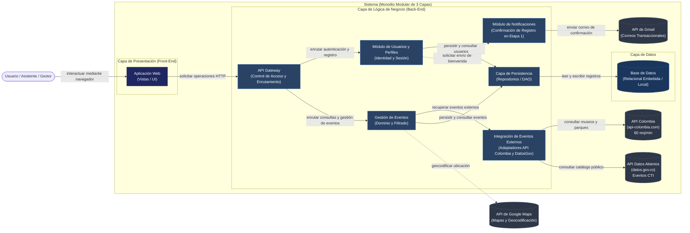
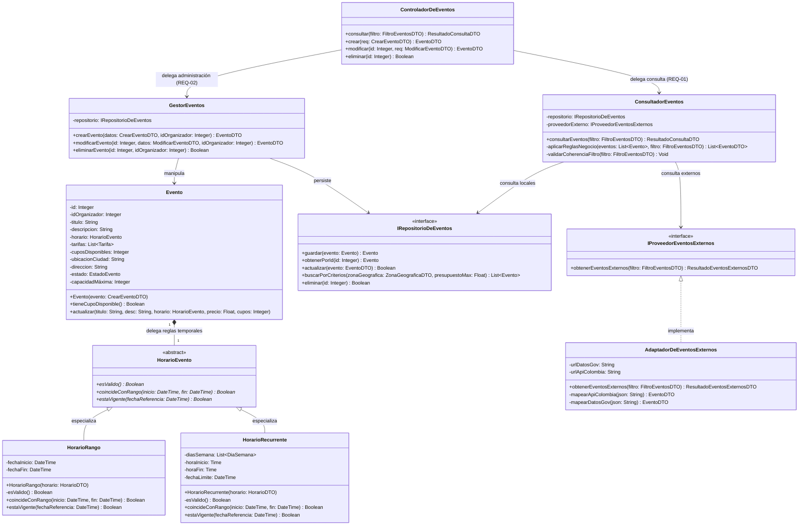
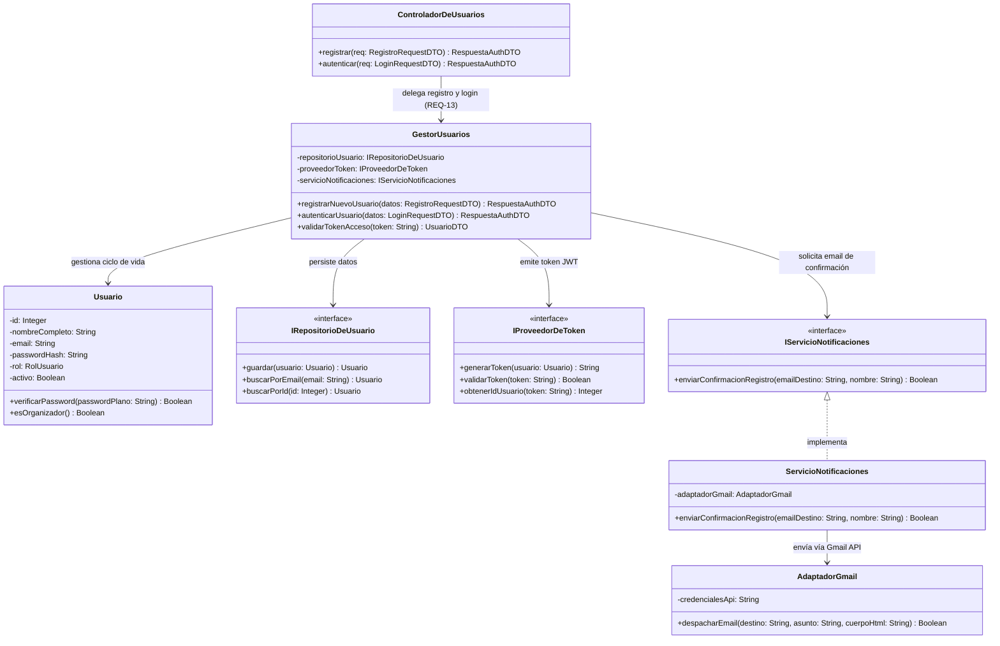

# Filtrado de eventos — Diseño Arquitectónico detallado v1.0

| | |
|---|---|
| **Team** |Power Rangers|
| **Members** |Cristian Andres Diaz Ortega - Juan Sebastian Rodriguez Carvajal - Martin Lora Caro - Justin David Vargas Vasquez -Nicolas David Lovera Cabiativa |
| **Status** | Listo para revisar |
| **Date** | 17/10/2026 |
| **Inputs** | `docs/requerimientos/` |

---

## 1. System Overview & Design Drivers

**Propósito del sistema**
> Proveer una plataforma accesible que permita a los asistentes descubrir y filtrar eventos viables según su presupuesto, disponibilidad de tiempo y ubicación geográfica, facilitando a los organizadores la gestión y publicación confiable de sus actividades en un entorno seguro y centralizado.

**Requerimientos que moldean la estructura (Alcance Primera Etapa: REQ-01, REQ-02, REQ-13)**

| Requerimiento / ID Caso de Uso | Por qué moldea la estructura | Atributo de calidad, restricción o regla de negocio involucrada |
|---|---|---|
| **REQ-01 / Consultar y Filtrar Eventos** | Requiere evaluar criterios multidimensionales (presupuesto, horario y zona), consultando tanto registros locales como APIs externas de eventos. Demanda aislar las llamadas externas detrás de adaptadores con timeout estricto y fallback para que la lentitud, las caídas o las cuotas de terceros no degraden la experiencia. | **Restricción:** Integrar APIs externas bajo límites de cuota (60 req/min por IP en `api-colombia.com`). **Calidad:** Disponibilidad de la experiencia de consulta, tolerancia a fallos y bajo tiempo de respuesta. **Reglas:** BR-01 (al menos 1 cupo disponible), BR-02 (tarifa mínima y presupuesto) y BR-03 (filtros combinables). |
| **REQ-02 / Administrar Eventos** | Las operaciones de creación, edición y cancelación de eventos alteran el estado del catálogo y requieren validación de coherencia en fechas, aforos y precios, además de control transaccional en el almacenamiento. | **Calidad:** Consistencia e integridad de datos. **Regla de dominio:** Un evento debe poseer al menos una tarifa y un horario válido antes de ser publicado en el catálogo. |
| **REQ-13 / Registro y Creación de Cuenta** | La identificación de usuarios exige separar las responsabilidades de gestión de credenciales, hashing seguro y emisión de tokens de la lógica de eventos, controlando el acceso a operaciones administrativas y disparando notificaciones de confirmación vía correo. | **Restricción:** Políticas de seguridad y unicidad de cuenta. **Calidad:** Confidencialidad, desacoplamiento de la identidad y trazabilidad de sesión. |

---

## 2. Architectural Design

*(Vista externa: delimitación de fronteras, componentes de alto nivel, responsabilidades e interacciones según `Arquitectura_de_Software_en_Capas_3.drawio` y ADR-0005).*

### 2.1 Frontera del Sistema y Contexto (System Context & Boundary)

| Elemento fuera del sistema | Tipo | Cómo interactúa el sistema con él |
|---|---|---|
| **Usuario (Asistente / Gestor)** | Actor humano | Interactúa con la Aplicación Web para autenticarse, consultar y filtrar eventos compatibles, o crear y modificar eventos si posee permisos de organizador. |
| **API de Eventos y Datos Territoriales** | Sistemas externos | 1. `https://api-colombia.com/`: Datos de atracciones turísticas que Colombia tiene para ofrecer, desde museos hasta parques naturales, operada bajo un límite de 60 req/min por IP.<br/> `https://www.datos.gov.co/.../xm7a-7paj/about_data`: Catálogo oficial de eventos abiertos nacionales e internacionales de CTI. |
| **API de Google Maps** | Sistema externo | El sistema interactúa con ella para geocodificación y normalización de direcciones. |
| **API de Gmail** | Sistema externo | Servicio de correo externo utilizado por el sistema para confirmación de registro (`REQ-13`) y alertas de cuenta. |

---

### 2.2 Componentes, Responsabilidades y Capacidades

El sistema está estructurado como un **Monolito Modular de 3 Capas** (Presentación, Lógica de Negocio y Datos), delimitado en estricta correspondencia con "Arquitectura_de_Software_en_Capas_3.drawio" :



#### Tabla de Responsabilidades de Componentes

| Componente | Capa Arquitectónica | Responsabilidad Principal | Requerimientos Soportados | Capacidades Provistas | Capacidades Requeridas | Dependencias Principales |
|---|---|---|---|---|---|---|
| **Aplicación Web** | Front-End | Renderizar vistas interactivas, capturar formularios de filtrado, creación de eventos y registro, y presentar resultados. | `REQ-01`, `REQ-02`, `REQ-13` | Interacción de usuario, captura de filtros y visualización de catálogo. | Enviar solicitudes HTTP/REST hacia el API Gateway. | API Gateway |
| **API Gateway** | Back-End | Punto único de entrada al Back-End: autentica peticiones, valida tokens de sesión y enruta las solicitudes al módulo de negocio correspondiente. | `REQ-01`, `REQ-02`, `REQ-13` | Enrutamiento de solicitudes, validación de sesión y autorización por rol. | Ejecutar casos de uso en módulos de negocio. | Gestión de Eventos, Módulo de Usuarios y Perfiles |
| **Gestión de Eventos** | Back-End | Contiene la lógica de dominio de eventos: validación de reglas BR-01, BR-02 y BR-03, cálculo de solapamiento horario y orquestación de operaciones CRUD. | `REQ-01`, `REQ-02` | `consultarEventos(filtro)`, `crearEvento(datos)`, `modificarEvento(id, datos)`, `eliminarEvento(id)`. | Consultar eventos locales y obtener eventos de terceros formateados. | Integración de Eventos Externos, Capa de Persistencia |
| **Integración de Eventos Externos** | Back-End | Adaptador que aísla la comunicación con las APIs externas (`api-colombia.com` y `datos.gov.co`), aplicando un timeout estricto de 2 segundos y fallback ante la indisponibilidad o los errores de los proveedores. | `REQ-01` | `obtenerEventosExternos(filtro)` | Consumir APIs REST externas bajo cuotas y timeouts estrictos. | API Colombia, Datos Abiertos Gov.co |
| **Módulo de Usuarios y Perfiles** | Back-End | Gestionar el registro de usuarios, validación de credenciales, hashing seguro de contraseñas y emisión de tokens de autenticación. | `REQ-13` | `registrarUsuario(datos)`, `autenticarUsuario(credenciales)`, `validarSesion(token)`. | Guardar credenciales y solicitar confirmación por email. | Capa de Persistencia, Módulo de Notificaciones |
| **Módulo de Notificaciones** | Back-End | Gestionar el despacho de mensajes y correos transaccionales a usuarios. En la Primera Etapa atiende la confirmación de registro (`REQ-13`) vía Gmail; en fases posteriores atenderá avisos de eventos modificados (`REQ-12`). | `REQ-13` | `despacharCorreoConfirmacion(usuario)` | Consumir API de Gmail externa. | API de Gmail (Terceros) |
| **Capa de Persistencia** | Back-End | Implementar repositorios y DAOs para abstraer las sentencias SQL y desacoplar a las entidades de negocio de los detalles del motor de base de datos. | `REQ-01`, `REQ-02`, `REQ-13` | `guardarEvento()`, `buscarEventos()`, `guardarUsuario()`, `buscarUsuarioPorEmail()`. | Conectividad y ejecución relacional. | Base de Datos |
| **Base de Datos** | Datos | Almacenar físicamente de manera consistente los registros de eventos, horarios, usuarios y perfiles. | `REQ-01`, `REQ-02`, `REQ-13` | Almacenamiento ACID persistente. | Ninguna | Ninguna |

---

## 3. Detailed Design

*(Vista interna: cómo están diseñados por dentro los componentes seleccionados de la Primera Etapa).*

### 3.1 Componentes Seleccionados

| Componente | Justificación de Selección (Riesgo, Complejidad, Centralidad en Drivers) |
|---|---|
| **Gestión de Eventos** | Núcleo transaccional del sistema. Implementa `REQ-01` (evaluación polimórfica de horarios, filtrado multidimensional, integración de `api-colombia.com` y `datos.gov.co`) y `REQ-02` (invariantes de dominio para administración de eventos). |
| **Módulo de Usuarios y Perfiles** | Centralidad en el driver de seguridad e identidad (`REQ-13`). Garantiza el registro atómico, unicidad de cuenta, generación de tokens seguros y despacho de confirmación de registro a través del Módulo de Notificaciones. |

---

### 3.2 Diagramas de Clases (Class Diagrams)

para mejor lectura se dividio en dos diagramas estructurales enfocados en cada controlador y módulo principal:

#### 3.2.1 Diagrama de Clases — Componente Gestión de Eventos (`ControladorDeEventos`)



---


#### 3.2.2 Diagrama de Clases — Componente Módulo de Usuarios y Perfiles (`ControladorDeUsuarios`)




---

### 3.3 Tabla de Responsabilidades de Clases

| Clase | Componente al que pertenece | Responsabilidad | Colaboradores clave |
|---|---|---|---|
| `ControladorDeEventos` | Gestión de Eventos | Expone endpoints HTTP de la capa de entrada para consultar y administrar eventos; valida esquemas de entrada. | `ConsultadorEventos`, `GestorEventos` |
| `ConsultadorEventos` | Gestión de Eventos | Coordina la consulta a la persistencia local y al adaptador externo unificado, unifica resultados y aplica filtros de dominio (BR-01, BR-02, BR-03). | `IRepositorioDeEventos`, `IProveedorEventosExternos` |
| `GestorEventos` | Gestión de Eventos | Aplica reglas de creación, actualización y eliminación de eventos locales, validando permisos del organizador. | `Evento`, `IRepositorioDeEventos` |
| `Evento` | Gestión de Eventos | Entidad de dominio que valida los campos en el momento de la creación y actaulización de un evento, además de validar el aforo  | `HorarioEvento` |
| `HorarioEvento` | Gestión de Eventos | Clase abstracta (Value Object) que define el contrato de validación y solapamiento temporal. | Ninguno |
| `HorarioRango` | Gestión de Eventos | Especialización de horario para eventos continuos delimitados por fecha/hora de inicio y fin. | `HorarioEvento` |
| `HorarioRecurrente` | Gestión de Eventos | Especialización de horario para eventos periódicos por días de la semana y franja horaria. | `HorarioEvento` |
| `IRepositorioDeEventos` | Capa de Persistencia | Interfaz de abstracción DAO para operaciones de persistencia y búsqueda relacional de eventos. | `Evento` |
| `IProveedorEventosExternos` | Integración de Eventos Externos | Interfaz que define el contrato para recuperar eventos de fuentes remotas. | `ResultadoEventosExternosDTO` |
| `AdaptadorDeEventosExternos` | Integración de Eventos Externos | Implementa el consumo HTTP unificado de `datos.gov.co` y `api-colombia.com`, gestionando mapeos a entidades de dominio, el timeout de 2 segundos y el fallback ante fallas del proveedor. | (API de Datos Abiertos Gov.co, API Colombia) |
| `ControladorDeUsuarios` | Módulo de Usuarios y Perfiles | Expone endpoints HTTP para registro y autenticación de usuarios. | `GestorUsuarios` |
| `GestorUsuarios` | Módulo de Usuarios y Perfiles | Aplica lógica de negocio de registro: verificación de email único, hashing de contraseña, expedición de tokens y solicitud de email de bienvenida. | `Usuario`, `IRepositorioDeUsuario`, `IProveedorDeToken`, `IServicioNotificaciones` |
| `Usuario` | Módulo de Usuarios y Perfiles | Entidad de dominio que representa al usuario, su perfil, rol (Asistente/Organizador) y validación de hash de contraseña. | Ninguno |
| `IRepositorioDeUsuario` | Capa de Persistencia | Interfaz de abstracción para persistir y buscar entidades de usuario por email o ID. | `Usuario` |
| `IProveedorDeToken` | Módulo de Usuarios y Perfiles | Interfaz para generación y verificación de tokens seguros de sesión (JWT). | `Usuario` |
| `IServicioNotificaciones` | Módulo de Notificaciones | Puerto/Interfaz de aplicación que desacopla el envío de notificaciones y confirmaciones. | `GestorUsuarios` |
| `ServicioNotificaciones` | Módulo de Notificaciones | Implementación del servicio de notificaciones que coordina el despacho de correos transaccionales. | `AdaptadorGmail` |
| `AdaptadorGmail` | Módulo de Notificaciones | Adaptador de infraestructura que consume la API de Gmail para enviar correos electrónicos formateados. | (API de Gmail externa) |

---

### 3.4 Comportamiento de una Operación Clave

Operación seleccionada: `consultarEventos(filtro)` de la clase `ConsultadorEventos` (Implementa el flujo principal, alternativo y contingencia de `REQ-01`):

```text
consultarEventos(filtro):
    TRY:
        validarCoherenciaFiltro(filtro)
    EXCEPTION (invalidField):
         throw(invalidField) // Lanza ErrorValidacion si precios son negativos o fechas incoherentes
    eventosLocales = repositorio.buscarPorCriterios(filtro.zonaGeografica, filtro.presupuestoMaximo)
    
    TRY:
        respuestaExterna = IProveedorEventosExternos.obtenerEventosExternos(filtro) // timeout max 2000 ms
        eventosExternos = respuestaExterna.eventosValidados
    EXCEPTION (TimeoutError, NetworkError):
        registrarAdvertencia("API externa inaccesible; continuando con catálogo local")
        eventosExternos = LISTA_VACIA
    
    eventosConsolidados = unificar(eventosLocales, eventosExternos)
    
    listaFinal = []
    FOR evento IN eventosConsolidados:
        IF evento.tieneCupoDisponible():
            IF filtro.rangoHorario ES NULO O evento.horario.coincideConRango(filtro.rangoHorario):
                listaFinal.agregar(mapearADTO(evento))
                
    RETURN listaFinal // Retorna lista vacía si no hay coincidencias (Flujo Alternativo)
```

---

## 4. Design Quality — Cohesión, Acoplamiento y Ocultamiento de Información

| Criterio | Análisis con Evidencia del Diseño |
|---|---|
| **Cohesión** | Alta cohesión por separación de responsabilidades: `ConsultadorEventos` se encarga exclusivamente de resolver búsquedas y aplicar reglas de consulta (BR-01/02/03); `GestorEventos` concentra el ciclo de vida administrativo; `HorarioEvento` y sus subclases encapsulan la lógica temporal; y `GestorUsuarios` se dedica exclusivamente a la identidad. Ninguna clase mezcla presentación, persistencia o consumo HTTP. |
| **Acoplamiento** | Bajo acoplamiento mediante interfaces: los servicios de aplicación (`ConsultadorEventos`, `GestorUsuarios`) dependen de abstracciones (`IRepositorioDeEventos`, `IProveedorEventosExternos`, `IServicioNotificaciones`). Los cambios en proveedores externos (`datos.gov.co`, `api-colombia.com`, `Gmail`) quedan encapsulados en sus respectivos adaptadores sin propagarse al dominio. |
| **Ocultamiento de información** | Los detalles mecánicos de conexión a la base de datos, consultas SQL, formatos JSON propietarios de las APIs externas y algoritmos de hashing o firmado de tokens JWT permanecen encapsulados como privados detrás de las interfaces. Los componentes externos solo interactúan mediante DTOs tipados. |

---

## 5. Design Decisions & Decision Record

### Decisión A — Arquitectónica (Architectural)

| | |
|---|---|
| **Contexto** | El sistema debe consultar eventos de proveedores externos (`datos.gov.co`, `api-colombia.com`) y almacenar eventos locales en base de datos sin acoplar la lógica de filtrado (`REQ-01`) a formatos cambiantes ni arriesgar la disponibilidad global ante caídas de red o límites de cuota (60 req/min). |
| **Decisión** | Adoptar una Arquitectura en Capas estricta (Monolito Modular) con un adaptador unificado de eventos externos (`AdaptadorDeEventosExternos`, que implementa `IProveedorEventosExternos` y consume `datos.gov.co` y `api-colombia.com`) y una Capa de Persistencia desacoplada (`IRepositorioDeEventos`), donde todo servicio externo interactúa mediante contratos estables con timeout y fallback ante indisponibilidad. |
| **Justificación** | Aislar las llamadas externas permite que las fallas, la lentitud o los errores de cuota de las APIs de terceros no interrumpan la consulta de eventos locales: ante cualquiera de ellos, el adaptador responde con una lista vacía de eventos externos y el sistema continúa con el catálogo local. |
| **Costo aceptado / Trade-off** | Introduce capas adicionales de indirección (DTOs, interfaces y adaptadores), requiriendo mayor número de clases y ligero incremento en latencia por mapeo de datos. |

### Decisión B — Diseño Detallado (Detailed Design)

| | |
|---|---|
| **Contexto** | Los eventos del catálogo presentan dos modalidades temporales dispares: eventos de fecha única/rango continuo y eventos recurrentes por días de la semana con fecha de expiración (`REQ-01` y `REQ-02`). |
| **Decisión** | Encapsular las reglas de tiempo mediante polimorfismo, utilizando una abstracción `HorarioEvento` (Value Object) de la que heredan `HorarioRango` y `HorarioRecurrente`. |
| **Justificación** | Desplaza la lógica de cálculo de fechas hacia objetos de valor específicos. Esto previene la acumulación de bloques condicionales anidados dentro de la entidad `Evento` y permite realizar pruebas unitarias aisladas y deterministas. |
| **Costo aceptado / Trade-off** | Aumenta el número de clases en la capa de dominio y requiere configurar adecuadamente la persistencia de datos para almacenar correctamente las distintas variantes de horarios (mediante discriminador o JSONB). |

### Registros de Decisión Arquitectónica (ADRs Vinculados)
* **Decisión A (Arquitectura en Capas y APIs):** Documentada formalmente en ADR-0004_APIS.md y ADR-0005_Arquitectura.md
* **Decisión B (Polimorfismo en Horarios):** Documentada formalmente en ADR-0006_Polimorfismo_Horarios_Eventos.md(Falta crearla, mañana lo hago).

---

## 6. Traceability (Trazabilidad de la Primera Etapa)

| ID Requerimiento | Caso de Uso | Componente(s) Arquitectónico(s) | Clase(s) del Diseño Detallado |
|---|---|---|---|
| **REQ-01** | Consultar y Filtrar Eventos | Aplicación Web, API Gateway, Gestión de Eventos, Integración de Eventos Externos, Capa de Persistencia | `ControladorDeEventos`, `ConsultadorEventos`, `Evento`, `HorarioEvento`, `HorarioRango`, `HorarioRecurrente`, `IProveedorEventosExternos`, `AdaptadorDeEventosExternos`, `IRepositorioDeEventos` |
| **REQ-02** | Administrar Eventos | Aplicación Web, API Gateway, Gestión de Eventos, Capa de Persistencia | `ControladorDeEventos`, `GestorEventos`, `Evento`, `HorarioEvento`, `HorarioRango`, `HorarioRecurrente`, `IRepositorioDeEventos` |
| **REQ-13** | Registrar Usuario / Autenticar | Aplicación Web, API Gateway, Módulo de Usuarios y Perfiles, Módulo de Notificaciones, Capa de Persistencia | `ControladorDeUsuarios`, `GestorUsuarios`, `Usuario`, `IRepositorioDeUsuario`, `IProveedorDeToken`, `IServicioNotificaciones`, `ServicioNotificaciones`, `AdaptadorGmail` |

---

## 7. Reflexión sobre Diseño Asistido por IA (AI-Assisted Design Reflection)

 >El uso de la IA como corrector permitió al equipo mejorar la calidad del entregable al detectar problemas que podían pasar desapercibidos en una revisión interna, así como reforzar la aplicación de buenas prácticas y lineamientos de clase. Sin embargo, se deja constancia de que esta herramienta se utilizó de manera ética y transparente, como un apoyo al proceso de diseño, y que la responsabilidad sobre el contenido final recae completamente en los integrantes del equipo, quienes comprenden y respaldan cada uno de los elementos presentados.
---

## 8. Consistency Checklist (Lista de Verificación de Consistencia)

- [x] Cada componente del diagrama aparece en la tabla de responsabilidades y viceversa.
- [x] Cada clase pertenece a un componente plenamente identificable.
- [x] Los componentes están nombrados por responsabilidad ("Gestión de Eventos", "Capa de Persistencia"), no por tecnología.
- [x] Nada dentro de la frontera del sistema es algo que el equipo no controle directamente.
- [x] Las capacidades requeridas y provistas coinciden entre componentes adyacentes.
- [x] Ambas decisiones de diseño explicitan costos y trade-offs reales, y están formalmente vinculadas con sus respectivos ADRs (`ADR-0004`, `ADR-0005` y `ADR-0006`).
- [x] El diagrama de clases está fragmentado en dos secciones Mermaid independientes (`ControladorDeEventos` y `ControladorDeUsuarios`) para mayor legibilidad y modularidad.
- [x] La integración del Módulo de Notificaciones está documentada y justificada arquitectónicamente.
- [x] La tabla de trazabilidad cubre exhaustivamente los requerimientos de la Primera Etapa (REQ-01, REQ-02, REQ-13) sin filas vacías ni clases huérfanas.
- [x] Los diagramas de Mermaid se renderizan correctamente con sintaxis válida para GitHub.
