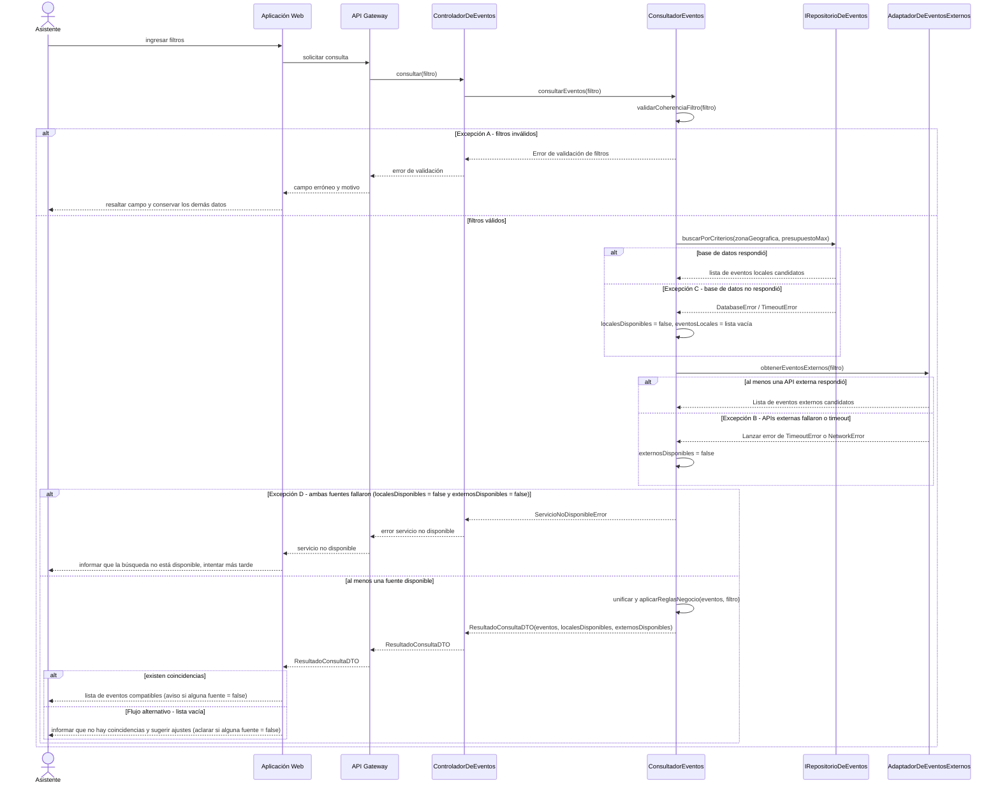
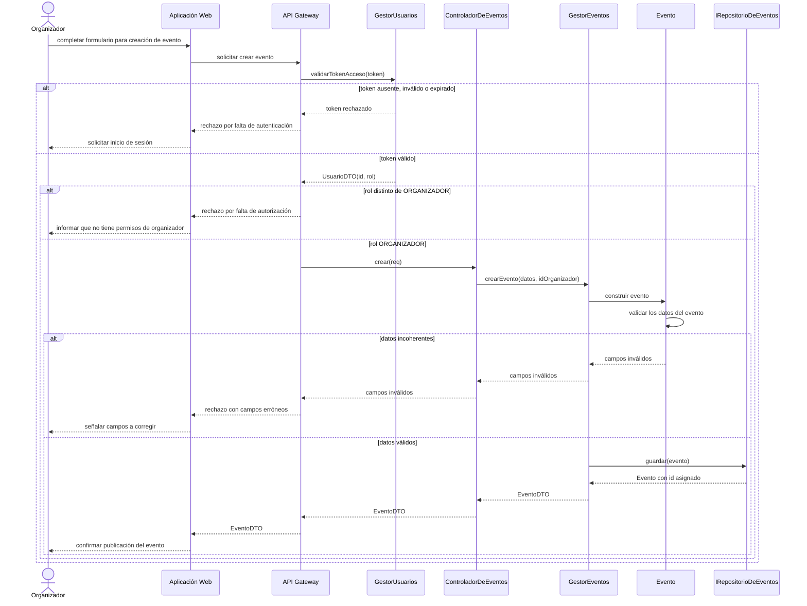
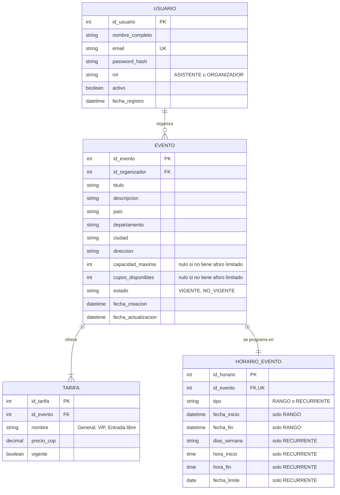

# Plataforma de Descubrimiento y Gestión de Eventos — Interaction & Data Design v1.0

| | |
|---|---|
| **Team** | Power Rangers |
| **Members** | Cristian Andrés Díaz Ortega - Juan Sebastián Rodríguez Carvajal - Martín Lora Caro - Justin David Vargas Vásquez - Nicolás David Lovera Cabiativa |
| **Status** | Listo para revisión |
| **Date** | 23/10/2026 |
| **Inputs** | `Docs/Design/Diseño Arquitectónico detallado 01.md`, Casos de uso y reglas en `Docs/Requirements/` y `Docs/Business Rules/`, Criterios de aceptación, Historias de usuario, ADR-0003 a ADR-0005. |

---

## 1. Behavior — Selected Use Cases (Comportamiento — Casos de uso seleccionados)

Se seleccionan dos casos de uso de la Primera Etapa con interacción significativa entre componentes:

| # | Caso de uso | Requerimiento | Motivo de selección |
|---|---|---|---|
| 1.1 | Consultar y Filtrar Eventos | `REQ-01` (capstone) | Núcleo de valor del sistema; involucra 5 componentes, dos sistemas externos de eventos y tres flujos no felices (Excepción A, Excepción B, flujo alternativo). |
| 1.2 | Administrar Eventos — Crear Evento | `REQ-02` / `US-02.1` | Única operación de la Etapa 1 que **modifica** el catálogo; obliga a hacer concreta la autorización (identidad y rol) y la persistencia transaccional del evento con sus tarifas y horario. |

### 1.1 Consultar y Filtrar Eventos — from requirement REQ-01

| Use Case step or flow | Message(s) in the diagram | Information exchanged | Operation defined in (Deliverable 1) |
|---|---|---|---|
| Flujo principal, pasos 1–2 (ingresar y enviar filtros) | `ingresar filtros`, `solicitar consulta`, `consultar`, `consultarEventos` | País, departamento, ciudad, presupuesto máximo, rango horario (todos opcionales) | `ControladorDeEventos.consultar(filtro)`, `ConsultadorEventos.consultarEventos(filtro)` |
| Flujo principal, paso 3 (validar formato y coherencia) | `validarCoherenciaFiltro` | `FiltroEventosDTO` | `ConsultadorEventos.validarCoherenciaFiltro(filtro)` |
| Flujo principal, paso 4 (consultar BD local) | `buscarPorCriterios`, `lista de Evento locales candidatos` | `zonaGeografica`, `presupuestoMax` → lista de `Evento` con eventos locales que cumplen con los filtros `zonaGeografica` y `presupuestoMax`| `IRepositorioDeEventos.buscarPorCriterios(zonaGeografica, presupuestoMax)` |
| Flujo principal, paso 5 (consultar APIs de eventos externas) | `obtenerEventosExternos`, lista de `Evento` | Filtro → lista de `Evento` con eventos externos que cumplen con los filtros `zonaGeografica` y `presupuestoMax` | `IProveedorEventosExternos.obtenerEventosExternos(filtro)` implementado por `AdaptadorDeEventosExternos`|
| Flujo principal, pasos 6–7  | `unificar y aplicarReglasNegocio` | Lista unificada de `Evento` que cumple los filtros dados | `ConsultadorEventos.aplicarReglasNegocio(eventos, filtro)` |
| Flujo principal, paso 8 (presentar resultados) | `ResultadoConsultaDTO`, `lista de eventos compatibles` | `ResultadoConsultaDTO(eventos, localesDisponibles, externosDisponibles)` | `ControladorDeEventos.consultar` devuelve `ResultadoConsultaDTO` |
| Flujo alternativo (sin coincidencias, paso 7) | `informar que no hay coincidencias y sugerir ajustes` | `ResultadoConsultaDTO` con lista vacía, `localesDisponibles`, `externosDisponibles` | `ControladorDeEventos.consultar` devuelve `ResultadoConsultaDTO` |
| Excepción A (criterios malformados, paso 3) | `Excepción A`, `Error de validación de filtros` | Campo erróneo y motivo | `ConsultadorEventos.validarCoherenciaFiltro(filtro)` lanza `ErrorValidacion` |
| Excepción B (timeout o falla de las APIs externas, paso 5) | `Excepción B`, `TimeoutError / NetworkError` | Error capturado → `eventosExternos` = lista vacía, `externosDisponibles = false` | `AdaptadorDeEventosExternos.obtenerEventosExternos` lanza el error (timeout 2 s); `ConsultadorEventos.consultarEventos` lo captura y continúa con eventos locales |
| Excepción C (base de datos no respondió, paso 4) | `Excepción C`, `DatabaseError / TimeoutError` | Error capturado → `eventosLocales` = lista vacía, `localesDisponibles = false` | `IRepositorioDeEventos.buscarPorCriterios` lanza el error; `ConsultadorEventos.consultarEventos` lo captura y continúa con la consulta externa |
| Excepción D (ambas fuentes fallaron, paso 5) | `Excepción D`, `ServicioNoDisponibleError`, `servicio no disponible` | `localesDisponibles = false` y error externo →  mensaje de servicio no disponible | `ConsultadorEventos.consultarEventos` lanza `ServicioNoDisponibleError` |

### 1.2 Administrar Eventos (Crear Evento) — from requirement REQ-02

| Use Case step or flow | Message(s) in the diagram | Information exchanged | Operation defined in (Deliverable 1) |
|---|---|---|---|
| Paso 1 — Organizador ingresa los datos del evento | `completar formulario para creación de evento` | `CrearEventoDTO` | Aplicación Web — captura de formularios |
| Paso 2 — Enviar solicitud de creación  | `solicitar crear evento` | Token, `CrearEventoDTO` | API Gateway — enrutamiento |
| Paso 3 — Verificar identidad y rol | `validarTokenAcceso(token)` | Token ,`UsuarioDTO` | `GestorUsuarios.validarTokenAcceso(token)` |
| Paso 4 — Delegar creación | `crear(req)` | `CrearEventoDTO`, `idOrganizador` | `ControladorDeEventos.crear(req)`, `GestorEventos.crearEvento(datos, idOrganizador)` |
| Paso 5 — Validar coherencia de los datos del evento | `construir evento` | Datos del evento | constructor de `Evento`, `HorarioEvento.esValido()` |
| Paso 6 — Persistir evento | `guardar(evento)` | `Evento` sin id asignada,`Evento` con id asignada | `IRepositorioDeEventos.guardar(evento)` |
| Paso 7 — Confirmar publicación| `EventoDTO`,`confirmar publicacíín de evento` | `EventoDTO` | `ControladorDeEventos.crear` → `EventoDTO` |
| token inválido | `token ausente, inválido o expirado` | Rechazo de autenticación | API Gateway / `validarTokenAcceso` |
| rol distinto de organizador | `rol distinto de ORGANIZADOR` | mensaje de Rechazo de autorización | API Gateway (autorización por rol), `Usuario.esOrganizador()` |
| datos de evento inválidos | `datos incoherentes` | `ErrorValidacion(campos)` | constructor de `Evento` , `HorarioEvento.esValido()` |

> **Nota de trazabilidad:** `REQ-02` está definido en `Requerimientos funcionales.md` y en la historia `US-02.1`, pero todavía no cuenta con un caso de uso detallado como el de `REQ-01`. Por esta razón, los pasos 1 a 7 de la tabla anterior se declaran como **[SUPUESTO]** del equipo, derivados de `US-02.1` y de la regla de dominio "un evento debe tener al menos una tarifa y un horario válido antes de publicarse", y se confirmarán cuando se redacte el caso de uso de `REQ-02`. Asimismo, `US-02.1` menciona imagen, tipo de evento, atributos y productos ofrecidos, que no se modelan en esta etapa **[SUPUESTO]**.

---

## 2. Data Design (Diseño de datos)

### 2.1 Principal information the system needs (Información principal)

| Information | Needed by (use cases) | Persisted? | Why (or why not) |
|---|---|---|---|
| **Usuario** (identificación, email, hash de contraseña, rol, estado) | Registrar/Autenticar (`REQ-13`), Crear Evento (`REQ-02`, autorización) | **Sí** | Es propiedad del sistema y debe sobrevivir entre sesiones; el email único y el rol son la base de la autorización. |
| **Evento local** | Consultar (`REQ-01`), Crear/Modificar/Eliminar (`REQ-02`) | **Sí** | El sistema es el dueño autoritativo de los eventos creados por organizadores. |
| **Tarifas del evento** | Consultar (`REQ-01`, BR-02), Crear (`REQ-02`) | **Sí** | BR-02 trabaja sobre múltiples tarifas vigentes; `US-02.1` exige registrar los productos ofrecidos.|
| **Eventos externos** (`datos.gov.co` y `api-colombia.com`) | Consultar (`REQ-01`) | **No** | Su dueño son los proveedores externos y el sistema no controla su ciclo de vida. Persistirlos crearía copias desactualizadas. Se consultan en tiempo real vía `AdaptadorDeEventosExternos` con timeout de 2 s.|
| **Filtros de búsqueda y resultados** | Consultar (`REQ-01`) | **No** | Son transitorios por petición |
| **Token de sesión** | Autenticar (`REQ-13`), Crear Evento (`REQ-02`) | **No** | Se asume un token autocontenido y firmado (JWT, Entregable 1 `IProveedorDeToken`).|
| **Correo de confirmación enviado** | Registrar (`REQ-13`) | **No** | Lo despacha y conserva la API de Gmail.|

### 2.2 Data model (Modelo de datos)

**Representación elegida: Opción A — Relacional.**
> Los datos de la Etapa 1 son entidades fuertemente relacionadas (usuario → evento → tarifas/horario), con restricciones de integridad (email único, FK de organizador, valores no negativos), y la creación de un evento con sus tarifas y horario debe ser **atómica**. Esto encaja con un modelo relacional, coherente con ADR-0003 y ADR-0005.

| Entity / document type | Meaning in the system | Identifier | Constraints (required, unique, allowed values) |
|---|---|---|---|
| `USUARIO` | Persona registrada que consulta eventos (asistente) o los administra (organizador). | `id_usuario` | `email` obligatorio y **único**; `password_hash` obligatorio (nunca se guarda la contraseña plana); `rol ∈ {ASISTENTE, ORGANIZADOR}`; `activo` obligatorio. |
| `EVENTO` | Evento local publicado por un organizador; el sistema es su dueño autoritativo. | `id_evento` | `id_organizador` obligatorio (FK a `USUARIO` con rol ORGANIZADOR); `capacidad_maxima` nula o `> 0`; `cupos_disponibles` nulo o `0 ≤ cupos ≤ capacidad_maxima`, y ambos nulos o ambos no nulos; `estado ∈ {VIGENTE, NO_VIGENTE}`. |
| `TARIFA` | Tipo de entrada con su precio en COP. | `id_tarifa` | `id_evento` obligatorio; `precio_cop ≥ 0` (0 = entrada libre); `nombre` único dentro del mismo evento; cada evento tiene **al menos una** tarifa. |
| `HORARIO_EVENTO` | Programación temporal del evento: rango continuo o recurrencia semanal. | `id_horario` | `id_evento` obligatorio y único (1:1); `tipo ∈ {RANGO, RECURRENTE}`; si `RANGO`: `fecha_inicio` y `fecha_fin` obligatorias con `fecha_fin > fecha_inicio`; si `RECURRENTE`: `dias_semana`, `hora_inicio`, `hora_fin`, `fecha_limite` obligatorios. |

### 2.3 Data Ownership (Propiedad de los datos)

| Information | Authoritative owner (component responsible for maintaining it) | Consumed by (uses it without owning it) | Access through |
|---|---|---|---|
| Usuario (credenciales, rol, estado) |**Módulo de Usuarios y Perfiles**| API Gateway (identidad y rol para autorizar); Gestión de Eventos (solo el `idOrganizador` recibido del Gateway) |`ControladorDeUsuarios`, `GestorUsuarios`, `IRepositorioUsuarios`|
| Evento local, Tarifa, Horario | **Gestión de Eventos**  | Aplicación Web (a través del API Gateway) | `ControladorDeEventos`, `IRepositorioDeEventos`,`GestorEventos`,`ConsultadorEventos` |
| Eventos externos |**Sistemas externos `datos.gov.co` y `api-colombia.com`**| Gestión de Eventos (`ConsultadorEventos`) | `IProveedorEventosExternos` → `AdaptadorDeEventosExternos` (consultas en tiempo real) |
| Token de sesión |**Módulo de Usuarios y Perfiles**| API Gateway | `GestorUsuarios.validarTokenAcceso(token)` |

> Todo lo persistido reside en una única base de datos relacional, a la que se accede exclusivamente a través de la Capa de Persistencia (`IRepositorioDeEventos`, `IRepositorioUsuarios`). Esta capa es el medio de acceso y no es dueña de ninguna información: la propiedad de cada dato corresponde al módulo indicado en la tabla.

### 2.4 Business rules and invariants enforced in data (Reglas e invariantes)

| Business rule or invariant | Where it is enforced (component logic / data constraint / both) | How |
|---|---|---|
| **BR-01** — Solo se muestran eventos con aforo limitado si tienen al menos 1 cupo | **Ambos** | Lógica: `Evento.tieneCupoDisponible()` retorna verdadero si `capacidad_maxima` es nula o `cupos_disponibles ≥ 1`; se aplica en `aplicarReglasNegocio` a eventos locales y externos. |
| **BR-02** — El evento califica si al menos una tarifa vigente es ≤ presupuesto | **Lógica**| `IRepositorioDeEventos.obtenerTarifaMinimaDeEvento(id) <= presupuestoMaximo`.|
| **BR-03** — Filtros combinables u omitidos; sin filtros, listado general | **Lógica** | `CriteriosBusqueda` con campos opcionales; el repositorio y `aplicarReglasNegocio` ignoran los criterios nulos.|
| Email único por usuario | **Ambos** | Lógica: `GestorUsuarios` verifica `buscarPorEmail` antes de registrar. Datos: restricción `UNIQUE(email)` en `USUARIO`. |
| Un evento tiene al menos una tarifa y un horario válido antes de publicarse | **Lógica** | `Evento` rechaza la construcción sin tarifas o con `HorarioEvento.esValido() = falso`; el repositorio guarda evento, tarifas y horario en una sola transacción. |
| Fin de horario posterior al inicio | **Ambos** | Lógica: `HorarioRango.esValido()`, `HorarioRecurrente.esValido()`. Datos: `CHECK(fecha_fin > fecha_inicio)` en `HORARIO_EVENTO` para el tipo `RANGO`. |
| Coherencia de columnas según el tipo de horario | **Ambos** | Lógica: polimorfismo de `HorarioEvento`. Datos: `CHECK` que exige las columnas de `RANGO` o las de `RECURRENTE` según el valor de `tipo`. |
| Solo el organizador dueño modifica o cancela su evento | **Ambos** | Lógica: `GestorEventos` compara el `idOrganizador` del usuario autenticado con el `id_organizador` del evento antes de modificarlo o cancelarlo. Datos: FK `id_organizador` hacia `USUARIO`. |

---

## 3. Interface Contract (Contrato de interfaz)

**Interaction chosen** (Flujo principal diagrama 1.1):
* Consultar(filtro: `FiltroEventosDTO`):  ResultadoConsultaDTO
### 3.2 consultarEventos

| Element | Specification |
|---|---|
| **Operation and purpose** | `consultarEventos(filtro: FiltroEventosDTO) : ResultadoConsultaDTO`. Retorna los eventos vigentes, locales y externos (de `datos.gov.co` y `api-colombia.com`), compatibles con los criterios provistos por el usuario.|
| **Input** (parameters and types) | `FiltroEventosDTO`: `zonaGeografica: pais: String, departamento: String, ciudad: String`, `presupuestoMaximo: Decimal (COP, ≥ 0)`, `rangoHorario: horario recurrente o por rango`. |
| **Output** (successful result and data structure) |   `ResultadoConsultaDTO: eventos: lista de EventosDTO, localesDisponibles: Boolean , externosDisponibles: Boolean` |
| **Preconditions** (what the caller must satisfy before invoking) | (1) El llamador es `ControladorDeEventos`, que ya validó que los campos del filtro tienen el tipo correcto. (2) Todos los campos de `FiltroEventosDTO` son opcionales. |
| **Postconditions** (what is guaranteed on successful completion) | (1) Cada evento retornado cumple **todos** los criterios provistos. (2) Si hay presupuesto, cada evento tiene al menos una tarifa vigente ≤ presupuesto. (3) Ningún evento con aforo limitado tiene 0 cupos. (4) `externosDisponibles = false` **solo si** ambas fuentes externas fallaron o superaron 2 s; `localesDisponibles = false` si la base de datos no respondió|
| **Failure outcomes** (each failure, and what state is left after it) | **`ErrorValidacion(campo, motivo)`** (Excepción A): presupuesto negativo, `rangoHorario.fin ≤ rangoHorario.inicio` o rango incompleto (solo inicio o solo fin); no se consulta ninguna fuente y la interfaz señala el campo erróneo conservando los demás datos. **Falla de una o de ambas fuentes externas** (Excepción B): En caso de que la base de datos local responda, se informa al usuario que los eventos externos no están disponibles. **No responde la base de datos** (Excepción C): En caso de que el proveedor de eventos externos responda, se informa al usuario que no hay eventos locales disponibles. **Tanto la fuente de eventos externos como la base de datos local fallaron** (Excepción D): Se informa al usuario que el servicio no está disponible. |
| **Invariants and side effects** (what must stay true, what may change) | **Solo lectura:** la operación **no modifica** el catálogo local, usuarios ni tarifas. |

### 3.3 validarCoherenciaFiltro

| Element | Specification |
|---|---|
| **Operation and purpose** | `validarCoherenciaFiltro(filtro: FiltroEventosDTO): void`. Operación privada de `ConsultadorEventos`, invocada únicamente por `consultarEventos`. Verifica que los criterios de búsqueda proporcionados sean coherentes entre sí y con las restricciones definidas para la consulta, antes de consultar cualquier fuente de información.|
| **Input (parameters and types)** | `filtro: FiltroEventosDTO`: `zonaGeografica: pais: String, departamento: String, ciudad: String`, `presupuestoMaximo: Decimal (COP)`, `rangoHorario: horario recurrente o por rango`. Todos los campos son opcionales. |
| **Output (successful result and data structure)** | Ninguno (`void`). Si la operación termina sin lanzar una excepción, significa que los criterios proporcionados son coherentes y `consultarEventos` puede continuar con `buscarPorCriterios` y `obtenerEventosExternos`. |
| **Preconditions (what the caller must satisfy before invoking)** | (1) El llamador es `consultarEventos`, perteneciente a la misma clase `ConsultadorEventos`. (2) El objeto `filtro` debe estar construido y sus campos deben tener los tipos de datos correspondientes, cuya validación corresponde a `ControladorDeEventos`. (3) Todos los campos del filtro son opcionales; por tanto, se permite recibir un filtro vacío `{}`. |
| **Postconditions (what is guaranteed on successful completion)** | (1) `presupuestoMaximo` es nulo o mayor o igual a cero. El valor `0` es válido. (2) Si `rangoHorario` corresponde a un horario por rango, debe contener ambos valores (`inicio` y `fin`); además, `fin` debe ser estrictamente posterior a `inicio`. (3) `zonaGeografica` admite cualquier combinación de campos presentes u omitidos, incluyendo búsquedas realizadas únicamente por ciudad. (4) El objeto `filtro` permanece exactamente igual que antes de ejecutar la operación. |
| **Failure outcomes (each failure, and what state is left after it)** | **`ErrorValidacion(campo, motivo)` (Excepción A):** se lanza cuando se identifica un criterio incoherente. Casos: **(a)** `presupuestoMaximo < 0` → `campo = presupuestoMaximo`, motivo `"no puede ser negativo"`. **(b)** `rangoHorario` por rango contiene únicamente `inicio` o únicamente `fin` → `campo = rangoHorario`, motivo `"rango incompleto"`. **(c)** `rangoHorario.fin <= rangoHorario.inicio` → `campo = rangoHorario`, motivo `"el fin debe ser posterior al inicio"`. `consultarEventos` captura la excepción y la propaga a `ControladorDeEventos`. No se consulta el repositorio ni las APIs externas. La interfaz señala el campo erróneo y conserva los demás datos ingresados. Tras el error no se modifica el estado del sistema. |
| **Invariants and side effects** | **Sin efectos secundarios:** no modifica `filtro`, el catálogo de eventos, los usuarios ni las tarifas. No invoca el repositorio ni los proveedores externos. Tampoco registra advertencias en el log, dado que estas corresponden a la Excepción B. La operación es determinista: su resultado depende exclusivamente de los valores recibidos en el filtro y no del reloj del sistema. |

### 3.4 buscarPorCriterios

| Element | Specification |
|---|---|
| **Operation and purpose** |`buscarPorCriterios`. Obtener los eventos locales que cumplen con los filtros de zonaGeográfica y presupuestoMáximo.|
| **Input (parameters and types)** |`zonaGeografica: pais: String, departamento: String, ciudad: String`, `presupuestoMaximo: Decimal (COP, ≥ 0) |
| **Output (successful result and data structure)** | Devuelve una lista de la clase `Evento` con los eventos locales que cumplen con los  filtros `zonaGeografica` y `presupuestoMaximo` |
| **Preconditions (what the caller must satisfy before invoking)** | Los filtros `presupestoMaximo` y `zonaGegrafica` son válidos|
| **Postconditions (what is guaranteed on successful completion)** | Lista de eventos locales que cumplen con los filtros `presupestoMaximo` y `zonaGeografica`|
| **Failure outcomes (each failure, and what state is left after it)** | **`Base de datos no responde` (Excepción C):** Se lanza un error indicando que la base de datos no responde|
| **Invariants and side effects** | **Sin efectos secundarios**|

* obtenerEventosExternos(filtro : FiltroEventosDTO): Lista de Evento (lista de eventos externos que cumplen con los filtros zonaGeografica y presupuestoMaximo)
* aplicarReglasNegocio(eventos: Lista de Evento, filtro: FiltroEventosDTO) : Lista de EventoDTO

**Testable examples**

*Datos de prueba locales:* **E1** "Concierto Parque", Bogotá, hoy 19:00–21:00, tarifas General $20.000 y VIP $50.000, cupos 30/100. **E2** "Taller Arte", Bogotá, hoy 18:30–20:00, tarifa única $35.000, cupos 0/20. **E3** "Feria Libro", Bogotá, hoy 18:00–22:00, Entrada libre $0, sin aforo limitado. **E4** "Obra Teatro", Bogotá, hoy 14:00–16:00, tarifa $15.000, cupos 10/50. **E5** "Expo Medellín", Medellín, hoy 09:00–11:00, tarifa $40.000, sin aforo limitado.

| Case | Before | Request | Expected |
|---|---|---|---|
| v1-Filtros combinados | E1–E5 cargados; APIs externas responden sin eventos de Bogotá | `ciudad = Bogotá, presupuestoMaximo = 50000, rango = hoy 18:00–22:00` | `eventos = [E1, E3]`. |
| con múltiples tarifas | Igual | `ciudad = Bogotá, presupuestoMaximo = 30000` | E1 califica (General $20.000 ≤ $30.000, aunque VIP sea $50.000); también E3 y E4.|
| cupos disponibles | Igual al primer caso | `ciudad = Bogotá, presupuestoMaximo = 40000, rango = hoy 18:00–22:00` | E2 (compatible en precio y horario, cupos = 0) **no** aparece. |
|  Excepción B | Igual; APIs externas no responden en 2 s | Mismo filtro de V1 | `eventos = [E1, E3]` (solo `LOCAL`), `externosDisponibles = false`; la UI muestra el aviso.|
| Excepción A | Igual | `presupuestoMaximo = -1000` o `rango = hoy 22:00–18:00` | `ErrorValidacion(campo = presupuestoMaximo y rangoHorario)`; no se consulta repositorio ni APIs externas. |
| Sin coincidencias | Igual | `ciudad = Medellín, presupuestoMaximo = 10000, rango = hoy 08:00–12:00` | `eventos = []`, éxito; la UI informa y sugiere ajustar filtros. |
| Sin filtros | Igual | `{}` | Éxito con el listado de eventos aleatorios, aquí E2 se excluye por cupos = 0. |

---

## 4. Cross-Consistency & Changes to Deliverable 1 (Consistencia cruzada)

| Check | Result |
|---|---|
| Every participant in a sequence diagram is an actor, a component, a class or an external system from Deliverable 1 | **Cumple.** Actores: Asistente, Organizador (Usuario del Entregable 1). Componentes: Aplicación Web, API Gateway. Clases: `ControladorDeEventos`, `ConsultadorEventos`, `GestorEventos`, `Evento`, `GestorUsuarios`, `IRepositorioDeEventos`, `AdaptadorDeEventosExternos`. Sistemas externos: API datos.gov.co, API Colombia (`api-colombia.com`). |
| Every message corresponds to a capability, operation or contract | **Cumple** Todos los mensajes mapean a operaciones del Entregable 1. |
| Every entity or document type is reflected in the class diagrams, or the reason it is not is stated | **Cumple.** `USUARIO` ↔ `Usuario`, `EVENTO` ↔ `Evento` (con `pais`, `departamento` y `ciudad`), `TARIFA` ↔ `Tarifa` (clase agregada al Entregable 1 en este entregable), `HORARIO_EVENTO` ↔ `HorarioEvento` / `HorarioRango` / `HorarioRecurrente`. |
| Every persisted information element has exactly one authoritative owner | **Cumple.** Usuario → Módulo de Usuarios; Evento, Tarifa y Horario → Gestión de Eventos. |
| The contract agrees with the sequence diagram and with the data model (same behavior in all three views) | **Cumple** `externosDisponibles` aparece en el diagrama (Excepción B), en el contrato (postcondición 4). Se usa `TARIFA.vigente` y `precio_cop` en el modelo, `tarifaMinimaVigente` en el contrato y la regla se implementa en `aplicarReglasNegocio`.|

**Changes made to Deliverable 1 because of this deliverable**
> Al concretar el comportamiento y los datos se actualizó el Entregable 1 en los siguientes puntos:
> 1. Se unificó el consumo de las APIs externas en `AdaptadorDeEventosExternos` (CTI en `datos.gov.co` y museos/parques en `api-colombia.com`), eliminando la interfaz `IProveedorGeografico`, los adaptadores `AdaptadorEventosDatosGov` y `AdaptadorApiColombia` y la operación `obtenerDepartamentosYCiudades()`, ya que ningún flujo de los casos de uso seleccionados los utiliza.
> 2. `ConsultadorEventos.consultarEventos` y `ControladorDeEventos.consultar` pasan a retornar `EventosDTO` (lista de eventos y bandera `externosDisponibles`) para poder informar la Excepción B.
> 3. Se agregó la clase `Tarifa` al diagrama de clases de Gestión de Eventos, coherente con la entidad `TARIFA` del modelo de datos.
> 4. `Evento` incorpora los atributos `pais` y `departamento`, y su operación `actualizar` recibe la lista de tarifas en lugar de un precio único.
---

## 5. Open Questions (Preguntas abiertas)

| ID | Pregunta | Consecuencia si no se resuelve | Decisión necesaria / responsable |
|---|---|---|---|
| `OQ-01` | Los eventos externos de `datos.gov.co` o `api-colombia.com` pueden no traer precio ni cupos. ¿Se incluyen o se excluyen cuando el usuario filtra por presupuesto o aforo? | BR-01 y BR-02 no pueden evaluarse sobre datos ausentes; incluirlos o excluirlos cambia los resultados. | Equipo, tras revisar el esquema real de ambos datasets. |
| `OQ-02` | Política ante HTTP 429 de una API externa (reintentos) — pregunta abierta 2 de `REQ-01`. | Hoy el 429 se trata como "error HTTP" y activa el fallback con eventos locales; no hay política de reintentos definida. | Equipo. |
| `OQ-03` | `REQ-02` aún no tiene un caso de uso detallado; los pasos del diagrama 1.2 son supuestos derivados de `US-02.1`. | La trazabilidad del diagrama 1.2 queda sujeta a la redacción del caso de uso de `REQ-02`. | Equipo. |
---

## 6. Optional — AI-Assisted Design Reflection (Reflexión sobre diseño asistido por IA)

> *Sección para completar por el equipo. No se describe aquí una experiencia que el equipo no haya tenido.*
>
> **Recomendación de la IA:** Crear la entidad `TARIFA`
> 
> **Decisión del equipo:** Aceptada
> 
> **Razón:** Como un evento puede tener diferente tipos de tarifas (cada una con su nombre, precio, estado), es más natural verla como una entidad aparte que se relaciona con `EVENTO`

---

## 7. Consistency Checklist (Lista de verificación)

- [x] Two use cases from the project, each traceable to a Use Case written in the requirements. — *1.1 trazable a `REQ-01`. 1.2 trazable a `US-02.1`*
- [x] Each sequence diagram shows the main flow and at least one alternative or exception flow.
- [x] No business behavior is invented: anything unspecified is marked as an assumption or Open Question.
- [x] Section 2.1 explains what is NOT persisted as well as what is.
- [x] The data model has identifiers, relationships and constraints, not only boxes.
- [x] Every piece of principal information has one authoritative owner, and consumers are listed (Section 2.3).
- [x] The contract defines input, output, preconditions, postconditions and failure outcomes.
- [x] Sequence, data model and contract describe the same behavior.
- [x] Diagrams render correctly on GitHub (or the exported images are embedded).

---
