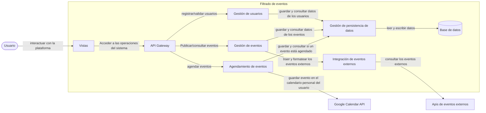

# Filtrado de eventos — Diseño Arquitectónico detallado v1.0

| | |
|---|---|
| **Team** |Power Rangers|
| **Members** |Cristian Andres Diaz Ortega - Juan Sebastian Rodriguez Carvajal - Martin Lora Caro - Justin David Vargas Vasquez -Nicolas David Lovera Cabiativa |
| **Status** | Listo para revisar |
| **Date** | 17/10/2026 |
| **Inputs** | `docs/requerimientos/` |

---

## 1. System Overview & Design Drivers

**System purpose** (2–3 sentences, in terms of the need it satisfies)
> El propósito de sistema es satisfacer la necesidad del usuario de encontrar eventos/actividades que se ajusten a sus condiciones.

| Requirement / Use Case ID | Why it shapes the structure | Quality attribute, constraint or business rule involved |
|---|---|---|
| REQ-01/Filtrar eventos| Principal funcionalidad del sistema,  se debe definir los responsables de validar filtros y realizar las consultas|BR-01,BR-O2 y BR-O3|
| REQ-02/Gestionar eventos| Crear, eliminar y actualizar eventos requiere de la definición sobre como y quiénes acceden a los datos locales | ninguno|
| REQ-07/Agendar eventos|Funcionalidad secundaria pero que interactúa con un sistema externo, debe definirse esa interacción |limitación: uso de sistema externo|
| REQ-13/Registrar usuarios|Se debe especificar como se valida la sesión del usuario |ninguno|

---

## 2. Architectural Design


### 2.1 System Context & Boundary

| Outside the system | Type (actor / external system / hardware) | How the system interacts with it |
|---|---|---|
|Asistente/gestor de eventos (usuario principal)|Actor|El usuario gestiona y consulta eventos mediante el sistema|
|Google calendar API|sistema externo|El sistema solicita agendar un evento al calendario personal del usuario|
|Apis para eventos externos|sistema externo|El sistema consulta eventos externos|

### 2.2 Components, Responsibilities & Capabilities



| Component | Main responsibility | Requirements / use cases supported | Provided capabilities | Required capabilities | Main dependencies |
|---|---|---|---|---|---|
|Vistas | Presenta la plataforma y recibe las acciones del usuario|`REQ-01`,`REQ-02`,`REQ-07`,`REQ-13`|Interactuar con la plataforma| Acceder a las operaciones del sistema | API Gateway|
|API Gateway | Recibe las solicitudes del usuario y las direcciona al módulo correspondiente| `REQ-01`,`REQ-02`,`REQ-07`,`REQ-13` |Acceder a las operaciones del sistema | Publicar/consultar eventos, registrar/validar usuarios y agendar eventos | Gestión de eventos, Gestión de usuarios, Agendamiento de eventos|
|Gestión de eventos | Define y Aplica los mecanismos para la publicación, consulta y filtrado de eventos| `REQ-01`,`REQ-02`|Publicar/consultar eventos | Guardar y consultar eventos| Gestión de persistencia de datos|
|Gestión de usuarios | Registra y valida a los usuarios|`REQ-13`|registrar/validar usuarios | Guardar y consultar datos de los usuarios |Gestión de persistencia de datos|
|Integración de eventos externos| solicita los datos de los eventos externos a las Apis proveedoras y formatea los datos obtenidos a la estructura de datos interna del sistema |`REQ-01` |traer y formatear eventos externos| consultar los eventos externos |Apis de eventos externos |
|Agendamiento de eventos|Agenda eventos al calendario personal del usuario mediante la API de google calendar|`REQ-07`|agendar eventos | guardar evento en el calendario personal del usuario |Google Calendar API|
|Gestión de persistencia de datos|Proporcionar acceso a los datos almacenados|`REQ-01`,`REQ-02`,`REQ-07`,`REQ-13`|Consultar, guardar y actualizar los datos de los eventos y usuarios | Leer y escribir en la base de datos | Base de datos |


---

## 3. Detailed Design

*(Inward-facing: how is each selected component designed internally?)*

### 3.1 Components selected (at least two)

| Component | Why it was selected |
|---|---|
| Gestión de eventos | Componente principal del sistema, el que despliega la mayor cantidad de funcionalidades |
| Gestión de usuarios | Necesario para permitirle al usuario crear una cuenta y persistir su información|

### 3.2 Class Diagram(s)

```mermaid
classDiagram
       %% --- Capa de Entrada ---
    class ControladorDeUsuarios {
        +registrar(req: RegistroRequest) UsuarioDTO
        +autenticar(req: LoginRequest) UsuarioDTO
        +validarSesion(token: String) UsuarioDTO
    }

    %% --- Capa de Aplicación ---
    class GestorUsuarios {
        +registrarUsuario(datos: UsuarioDTO) UsuarioDTO
        +autenticarUsuario(credenciales: CredencialesDTO) UsuarioDTO
        +validarSesion(token: String) UsuarioDTO
    }

    %% --- Capa de Dominio ---
    class Usuario {
        -id: Integer
        -nombre: String
        -email: String
        -token: String
    }

    %% --- Interfaces / Puertos de Infraestructura ---
    class IRepositorioDeUsuario {
        <<interface>>
        +guardar(usuario: UsuarioDTO) Boolean
        +encontrarPorNombre(nombre: string) UsuarioDTO
    }


    class IProveedorDeToken {
        <<interface>>
        +generarToken(usuario: UsuarioDTO) String
        +validarToken(token: String) Boolean
        +obtenerUsuario(token: String) UsuarioDTO
    }

    %% --- Relaciones ---
    ControladorDeUsuarios --> GestorUsuarios

    GestorUsuarios --> Usuario
    GestorUsuarios --> IRepositorioDeUsuario
    GestorUsuarios --> IProveedorDeToken
    %% --- Capa de Entrada ---
    class ControladorDeEventos {
        +crear(req: CrearEventoRequest) Boolean
        +modificar(id: String, req: ModificarEventoRequest) Boolean
        +eliminar(id: String) Boolean
        +consultar(req: ConsultaRequest) List~EventoDTO~
    }

    %% --- Capa de Aplicación ---
    class GestorEventos {
        +crearEvento(datos: EventoDTO) Boolean
        +modificarEvento(id: Integer, datos: EventoDTO) Boolean
        +eliminarEvento(id: Integer) Boolean
    }

    class ConsultadorEventos {
        +consultarEventos(filtro: FiltroDTO) List~EventoDTO~
    }

    %% --- Capa de Dominio ---
    class Evento {
        -id: Integer
        -idCreador:Integer
        -titulo: String
        -descripcion: String
        -horario: HorarioEvento
        -capacidad: Integer
        -lugar: String
        +actualizarInformacion(titulo, descripcion, horario, capacidad,lugar) Boolean
        +eliminar() Boolean
        +ocurreEn(fechaHora: DateTime) Boolean
        +estaCaducado(fechaReferencia: DateTime) Boolean
    }

    class HorarioEvento {
        <<abstract>>
        +esValido() Boolean*
        +ocurreEn(fechaHora: DateTime) Boolean*
        +estaCaducado(fechaReferencia: DateTime) Boolean*
    }

    class HorarioRango {
        -fechaInicio: DateTime
        -fechaFin: DateTime
        +esValido() Boolean
        +ocurreEn(fechaHora: DateTime) Boolean
        +estaCaducado(fechaReferencia: DateTime) Boolean
    }

    class HorarioRecurrente {
        -diasSemana: List~DiaSemana~
        -horaInicio: Time
        -horaFin: Time
        -tieneFechaLimite: Boolean
        -fechaLimite: DateTime
        +esValido() Boolean
        +ocurreEn(fechaHora: DateTime) Boolean
        +estaCaducado(fechaReferencia: DateTime) Boolean
    }

    %% --- Puertos / Interfaces de Infraestructura ---
    class IRepositorioDeEventos {
        <<interface>>
        +guardar(evento: EventoDTO) boolean
        +eliminarPorId(id: EventoId) boolean
        +buscar(filtro: FiltroDTO) List~EventoDTO~
    }

    class IAgendador {
        <<interface>>
        +agendar(evento: EventoDTO) Boolean
    }

    class IProveedorEventosExternos {
        <<interface>>
        +consultarEventosExternos(filtro: FiltroDTO) List~EventoDTO~
    }

    %% --- Relaciones ---
    ControladorDeEventos --> GestorEventos
    ControladorDeEventos --> ConsultadorEventos

    GestorEventos --> Evento
    GestorEventos --> IRepositorioDeEventos
    GestorEventos --> IAgendador

    ConsultadorEventos --> IRepositorioDeEventos
    ConsultadorEventos --> IProveedorEventosExternos

    Evento "1" *-- "1" HorarioEvento : programa con

    HorarioRango --|> HorarioEvento
    HorarioRecurrente --|> HorarioEvento


 
```



### 3.3 Class Responsibilities

| Class | Component it belongs to | Responsibility | Key collaborators |
|---|---|---|---|
| `ControladorDeEventos` | Gestión de eventos | Expone las operaciones de eventos. | `GestorEventos`, `ConsultadorEventos` |
| `GestorEventos` | Gestión de eventos | Solicita las operaciones de escritura (crear, modificar y eliminar) y el agendamiento de eventos| `Evento`, `IRepositorioDeEventos`, `IAgendador` |
| `ConsultadorEventos` | Gestión de eventos | valida los filtros de la consulta y la solicita | `IRepositorioDeEventos`, `IProveedorEventosExternos` |
| `Evento` | Gestión de eventos | Define los datos de un evento y las operaciones que se le realizan | `HorarioEvento` |
| `HorarioEvento` | Gestión de eventos | Clase abstracta (Value Object) que define las funciones de ocurrencia (`ocurreEn`) y caducidad (`estaCaducado`) | Ninguno |
| `HorarioRango` | Gestión de eventos | Implementa `HorarioEvento` con fecha y hora de inicio y fin delimitadas | `HorarioEvento` |
| `HorarioRecurrente` | Gestión de eventos |Implementa `HorarioEvento` con horarios periódicos por días de la semana y franja horaria| `HorarioEvento` |
| `IRepositorioDeEventos` | Gestíon de Persistencia de datos | Sirve de Puerto/Interfaz para operaciones CRUD en la base de datos local | Ninguno |
| `IAgendador` | Agendación de citas | Sirve de Puerto/Interfaz para agendar eventos en el calendario personal del usuario | Ninguno |
| `IProveedorEventosExternos` | Eventos externos | Sirve de Puerto/Interfaz para consumir eventos desde Apis de terceros | Ninguno|
| `ControladorDeUsuarios` | Gestíon de usuarios| Expone interfaz para las operaciones de registro y validación usuario | `GestorUsuarios` |
| `GestorUsuarios` | Gestión de usuarios | Implementa la lógica para validar usuario y registrarlo | `Usuario`, `IRepositorioDeUsuario`, `IProveedorDeToken` |
| `Usuario` | Gestión de usuarios | Define los datos del usuario (`id`, `nombre`, `email`, `token`)| Ningúno |
| `IRepositorioDeUsuario` | Gestíon de persistencia de datos| Puerto/Interfaz para consultar y persistir la información del usuario en la base de datos. | Ninguno |
| `IProveedorDeToken` | Gestíon de usuarios | Puerto/Interfaz responsable de generar, verificar y extraer datos desde tokens. | Ninguno |


### 3.4 Behavior of one key operation


```
autenticarUsuario(credencialesDTO):
    usuarioDTO = IRepositorioDeUsuario.encontrarPorNombre(credencialesDTO.nombre)
    IF usuarioDTO IS NULL THEN
        THROW ErrorAutenticacion("Usuario no encontrado")
    END IF

    IF usuarioDTO.contraseña != credencialesDTO.contraseña THEN
        THROW ErrorAutenticacion("contraseña incorrecta")
    END IF

    tokenJWT = IProveedorDeToken.generarToken(usuarioDTO)

    IF tokenJWT IS NULL  THEN
        THROW ErrorSeguridad("No se pudo emitir el token de sesión")
    END IF

    usuarioDTO.token = tokenJWT
    RETURN usuarioDTO

```

---

## 4. Design Quality — Cohesion, Coupling, Information Hiding

| Pregunta | Tu respuesta, con evidencia de tu diseño |
|---|---|
| **Cohesión**| Cada clase tiene un enfoque único y estrictamente definido. `ControladorDeEventos` solo define las firmas de las operaciones de eventos; `GestorEventos` se encarga de la implementacíon de la creación,eliminacion y actualización de eventos; `ConsultadorEventos` implementa la consulta y filtrado de eventos y `IRepositorioDeEventos` maneja las consultas que se necesitan a nivel de base de datos |
| **Acoplamiento**| La lógica de aplicación de alto nivel (`GestorUsuarios`) depende de interfaces abstractas (`IRepositorioDeUsuario`, `IProveedorDeToken`) en lugar de implementaciones concretas de base de datos o de técnicas de encriptación. Cambiar por ejemplo, el motor de base de datos, no requiere cambios en la lógica central de negocio |
| **Ocultamiento de información** | La información sobre como `IrepositorioDeEventos` y `IrepositorioDeUsuario` se implementan permanece oculta, el resto de componentes solo interactúan con `EventoDTO` y `UsuarioDTO`|

**Hallazgo en el diseño original y que se cambió**  
> Inicialmente, las responsabilidades de generación y validación de tokens estaban  dentro de `Usuario`. Se creó `IProveedorDeToken` para manejar la validación de usuario.  

---

## 5. Design Decisions & Decision Record

### Decision A — Architectural

| | |
|---|---|
| **Context**  |El sistema requiere desacoplar la lógica de negocio de eventos y usuarios respecto a los detalles mecánicos del almacenamiento, evitando dependencias directas con motores SQL/NoSQL o librerías ORM específicas en las capas de dominio y aplicación.|
| **Decision** |La comunicación con la base de datos se establecera exclusivamente atravez del módulo de gestión de persistencia de datos |
| **Rationale** |Aislar las consultas y operaciones transaccionales en un módulo especializado impide que sentencias SQL, contaminen la lógica de Gestión de eventos y Gestión de usuarios. Esto facilita las pruebas unitarias sin depender de una base de datos real y permite migrar o actualizar el motor de base de datos sin alterar la lógica de negocio del backend|
| **Trade-off accepted** |Se introduce una capa de abstracción adicional|

### Decision B — Detailed design

| | |
|---|---|
| **Context** |Los eventos del sistema tienen comportamientos temporales diferentes (rangos de fechas continuos o recurrencias periódicas con o sin fecha límite), y el sistema requiere consultar en los dos casos si los eventos ocurren en una fecha específica, o si los eventos ya finalizaron|
| **Decision** |Encapsular las reglas de tiempo mediante polimorfismo, utilizando una abstracción `HorarioEvento` de la que heredan `HorarioRango` y `HorarioRecurrente`|
| **Rationale** |Desplaza la lógica de cálculo de fechas hacia objetos de valor específicos. Esto previene la acumulación de bloques condicionales dentro de la entidad `HorarioEvento`|
| **Trade-off accepted** |Aumenta el número de clases en la capa de dominio y requiere configurar adecuadamente la persistencia de datos para almacenar correctamente las distintas variantes de horarios|

### ADR

At least one of the two decisions above must also be recorded as an ADR (use `Plantilla_ADR_Nygard`) in `docs/decisions/`.

**ADR file:** `docs/decisions/ADR-XXX-title.md` — records Decision [A / B].

---

## 6. Traceability

| Requirement ID | Use Case | Component(s) | Class(es) |
|---|---|---|---|
|REQ-01 |Filtrar eventos|`Vistas`,`API gateway`,`gestión de eventos`, `gestión de persistencia de datos`, `Integración de eventos externos`|`ControladorEventos`,`IProveedorEventosExternos`,`IRepositorioDeEventos`,`ConsultadorEventos`,`HorarioEvento`,`HorarioRango`,`HorarioRecurrente`|
|REQ-02 |Gestionar eventos|`Vistas`,`API gateway`,`gestión de eventos`, `gestión de persistencia de datos` |`ControladorEventos`,`GestorEventos`,`IRepositorioDeEventos`|
|REQ-07 |Agendar eventos|`Vistas`,`API gateway`,`Agendamiento de eventos`, `gestión de persistencia de datos` |`ControladorEventos`,`IAgendador`,`IRepositorioDeEventos`|
|REQ-13 |Registrar usuarios|`Vistas`,`API gateway`,`gestión de usuarios`, `gestión de persistencia de datos` |`ControladorEventos`,`ControladorDeUsuarios`,`gestorUsuarios`,`Usuario`,`IProveedorDeToken`,`IRepositorioDeUsuario` |

---

## 7. Optional — AI-Assisted Design Reflection

> N/A

---

## 8. Consistency Checklist

- [x] Every component in the diagram appears in the responsibilities table, and the other way around.
- [x] Every class belongs to an identifiable component.
- [x] Components are named by responsibility, not technology.
- [x] Nothing inside the system boundary is something you do not control.
- [x] Provided and required capabilities match across components (what one requires, another provides).
- [x] Both decisions name a real cost or limitation, and at least one has an ADR.
- [x] The traceability table has no empty rows and no orphan components or classes.
- [x] Diagrams render correctly on GitHub (or the exported images are embedded).

