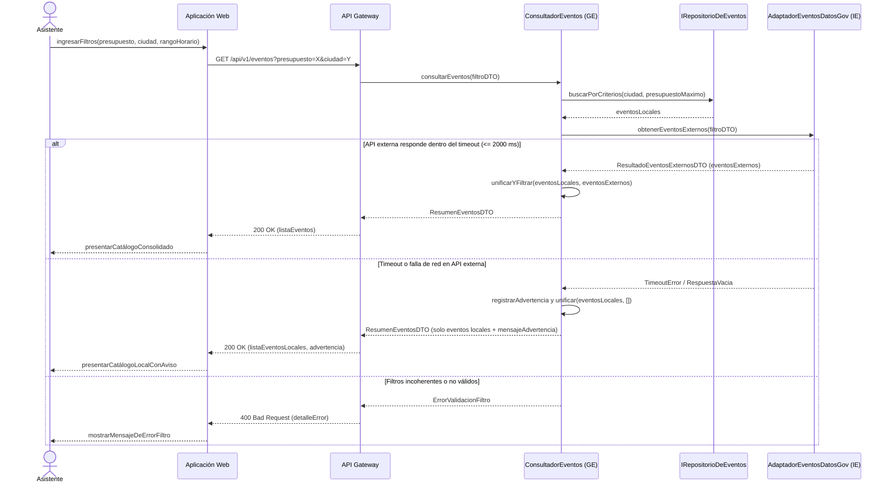
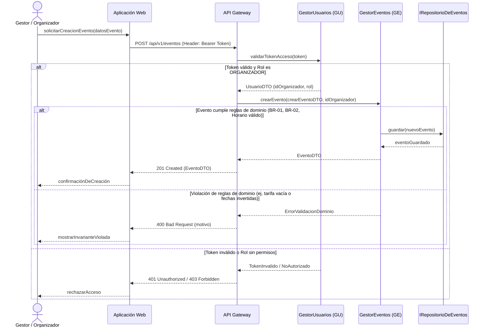
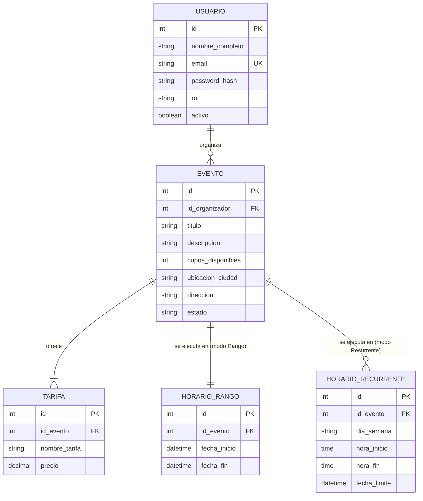

# Plataforma para Consultar y Administrar Eventos — Interaction & Data Design v1.0

| | |
|---|---|
| **Team** | Power Rangers |
| **Members** | Cristian Andres Diaz Ortega - Juan Sebastian Rodriguez Carvajal - Martin Lora Caro - Justin David Vargas Vasquez - Nicolas David Lovera Cabiativa |
| **Status** | Ready for review |
| **Date** | 23/10/2026 |
| **Inputs** | `docs/design/01_Architectural_and_Detailed_Design.md`, Casos de Uso en `docs/requirements/`, Interaction & Contracts Design v0.1 |

---

## 1. Behavior — Selected Use Cases

Se han seleccionado dos casos de uso críticos para el sistema: **REQ-01 (Consultar y Filtrar Eventos)** por ser el requerimiento capstone que involucra evaluación multidimensional e integración heterogénea con APIs externas, y **REQ-02 (Administrar Eventos)** por ser la operación transaccional principal de modificación de catálogo con validación estricta de reglas de dominio.

### 1.1 Consultar y Filtrar Eventos — de requerimiento [REQ-01]

| Use Case step or flow | Message(s) in the diagram | Information exchanged | Operation defined in (Deliverable 1) |
|---|---|---|---|
| Flujo principal, paso 1: Asistente especifica criterios de búsqueda | `ingresarFiltros`, `GET /api/v1/eventos` | Parámetros de filtro (`presupuesto`, `ciudad`, `rangoHorario`) | `Aplicación Web`, `API Gateway` |
| Flujo principal, paso 2: Consulta de catálogo local | `consultarEventos`, `buscarPorCriterios` | `filtroDTO` ($\text{ciudad}, \text{presupuestoMaximo}$) | `ConsultadorEventos.consultarEventos`, `IRepositorioDeEventos.buscarPorCriterios` |
| Flujo principal, paso 3: Consulta remota y unificación | `obtenerEventosExternos`, `ResultadoEventosExternosDTO` | `FiltroEventosDTO`, lista de eventos JSON mapeados a entidad `Evento` | `AdaptadorEventosDatosGov.obtenerEventosExternos` |
| Flujo principal, paso 4: Presentación de catálogo | `ResumenEventosDTO`, `200 OK` | Arreglo consolidado de `EventoDTO` con cupos y precios | `ControladorDeEventos.consultar` |
| Flujo alternativo / Contingencia: Indisponibilidad de API externa | Segundo bloque `alt` (`TimeoutError`) | Lista vacía de externos y mensaje de advertencia | Estrategia de Fallback en `ConsultadorEventos` |
| Excepción: Parámetros inválidos (ej. presupuesto negativo) | Tercer bloque `alt` (`ErrorValidacionFiltro`) | Código 400 y mensaje de validación | `ControladorDeEventos.consultar` |

---

### 1.2 Administrar Eventos (Creación de Evento) — de requerimiento [REQ-02]

| Use Case step or flow | Message(s) in the diagram | Information exchanged | Operation defined in (Deliverable 1) |
|---|---|---|---|
| Flujo principal, paso 1: Solicitud de creación de evento | `solicitarCreacionEvento`, `POST /api/v1/eventos` | Header Authorization Token, `CrearEventoDTO` | `Aplicación Web`, `API Gateway` |
| Flujo principal, paso 2: Autenticación y autorización por rol | `validarTokenAcceso` | Token JWT, `UsuarioDTO` | `GestorUsuarios.validarTokenAcceso` |
| Flujo principal, paso 3: Creación y persistencia de evento | `crearEvento`, `guardar` | `CrearEventoDTO`, ID de organizador, Entidad `Evento` | `GestorEventos.crearEvento`, `IRepositorioDeEventos.guardar` |
| Flujo alternativo: Datos de evento incoherentes (precios/fechas) | Bloque `alt` (`ErrorValidacionDominio`) | Mensaje explicativo de la invariante violada | `Evento.actualizar`, `HorarioEvento.esValido` |
| Excepción: Usuario no autenticado o rol inadecuado | Bloque `alt` (`401 / 403`) | Error de permisos | `API Gateway`, `GestorUsuarios` |

---

## 2. Data Design

### 2.1 Principal information the system needs

| Information | Needed by (use cases) | Persisted? | Why (or why not) |
|---|---|---|---|
| Usuarios y Credenciales | Registro (`REQ-13`), Administrar Eventos (`REQ-02`) | Yes | Se requiere autenticar gestores y asistentes, verificar roles y mantener la trazabilidad de autoría de eventos en el tiempo. |
| Eventos Locales, Horarios y Tarifas | Consultar Eventos (`REQ-01`), Administrar Eventos (`REQ-02`) | Yes | Conforman el catálogo propio de la plataforma. Su información debe ser durable y consistente transaccionalmente para soportar aforos y precios. |
| Zonas y Municipios de Colombia | Consultar Eventos (`REQ-01`) | No | Pertenecen a la base de datos territorial pública de `api-colombia.com`. Se consumen dinámicamente y se mantienen en memoria vía caché local en el adaptador `AdaptadorApiColombia` para no violar el límite de 60 req/min y evitar duplicar la fuente autoritativa. |
| Eventos de CTI (Externos) | Consultar Eventos (`REQ-01`) | No | Son propiedad del catálogo abierto de `datos.gov.co`. Almacenar una copia local crearía inconsistencias por datos desactualizados. Se consultan bajo demanda con estrategia de fallback. |

---

### 2.2 Data model

**Justificación:** Se selecciona un modelo **Relacional**. Los eventos, las tarifas, los horarios y las cuentas de usuario poseen reglas de integridad referencial estrictas (un evento no puede existir sin al menos un horario válido ni sin un organizador responsable). Adicionalmente, las consultas de filtrado requieren operaciones de unión e índices relacionales sobre atributos numéricos y temporales ($\text{tarifaMinima}$, $\text{ubicacionCiudad}$, $\text{fechaInicio}$).

| Entity / document type | Meaning in the system | Identifier | Constraints (required, unique, allowed values) |
|---|---|---|---|
| `USUARIO` | Cuenta de usuario de la plataforma (Asistente u Organizador) | `id` | `email` obligatorio y único (`UK`). `rol` limitado a `ASISTENTE` o `ORGANIZADOR`. `password_hash` no nulo. |
| `EVENTO` | Actividad o espectáculo publicado dentro del catálogo | `id` | `id_organizador` requerido (`FK`). `cupos_disponibles` $\ge 0$. `estado` limitado a `PUBLICADO`, `BORRADOR`, `CANCELADO`. |
| `TARIFA` | Opción de precio/boleta asociada a un evento determinado | `id` | `id_evento` requerido (`FK`). `precio` $\ge 0.00$. Todo evento publicado debe tener al menos una tarifa asociada. |
| `HORARIO_RANGO` | Delimitación temporal para eventos continuos de fecha fija | `id` | `fecha_fin` $>$ `fecha_inicio`. |
| `HORARIO_RECURRENTE` | Patron periódico de ejecución temporal para eventos recurrentes | `id` | `dia_semana` dentro de {`LUNES`, `MARTES`, `MIERCOLES`, `JUEVES`, `VIERNES`, `SABADO`, `DOMINGO`}. `hora_fin` $>$ `hora_inicio`. |

---

### 2.3 Data Ownership

| Information | Authoritative owner | Consumed by | Access through |
|---|---|---|---|
| Eventos locales, Tarifas y Horarios | Gestión de Eventos (almacenado vía Capa de Persistencia) | API Gateway, Aplicación Web | `ConsultadorEventos.consultarEventos`, `GestorEventos.crearEvento`, `IRepositorioDeEventos` |
| Cuentas de Usuario y Credenciales | Módulo de Usuarios y Perfiles | API Gateway, GestorEventos (validación de roles) | `GestorUsuarios.autenticarUsuario`, `GestorUsuarios.validarTokenAcceso`, `IRepositorioDeUsuario` |
| Datos Territoriales y Municipios | API Colombia (Sistema Externo) | Integración de Eventos Externos (solamente `AdaptadorApiColombia`) | `IProveedorGeografico.obtenerMunicipiosPorDepartamento` |
| Eventos Abiertos de CTI | Datos Abiertos Gov.co (Sistema Externo) | Integración de Eventos Externos (solamente `AdaptadorEventosDatosGov`) | `IProveedorEventosExternos.obtenerEventosExternos` |

---

### 2.4 Business rules and invariants enforced in data

| Business rule or invariant | Where it is enforced | How |
|---|---|---|
| **BR-01:** Un evento debe tener al menos 1 cupo disponible para ser retornado en las consultas del asistente | Ambos | **Lógica de componente:** `Evento.tieneCupoDisponible()` retorna verdadero si `cuposDisponibles > 0`. **Datos:** Restricción check en base de datos (`cupos_disponibles >= 0`). |
| **BR-02:** Tarifas acordes al presupuesto del usuario | Ambos | **Lógica de componente:** `ConsultadorEventos` evalúa si `tarifaMinima <= presupuestoMaximo`. **Datos:** Restricción de columna `TARIFA.precio >= 0.00`. |
| **BR-03:** Coherencia en rangos de fechas y horas | Ambos | **Lógica de componente:** `HorarioRango.esValido()` verifica que la fecha final sea posterior a la inicial. **Datos:** Restricción Check SQL (`fecha_fin > fecha_inicio`). |
| Autoría y Permisos de Modificación | Lógica de componente | `GestorEventos` valida que el `idOrganizador` del token coincida exactamente con el `id_organizador` registrado en la entidad `Evento`. |

---

## 3. Interface Contract

**Interaction chosen** (del Diagrama de Secuencia 1.1, mensaje `obtenerEventosExternos(filtroDTO)` entre `ConsultadorEventos` y el adaptador `AdaptadorEventosDatosGov` de Integración de Eventos Externos):
> Este contrato define el punto crítico donde la lógica de consulta interna se comunica con el adaptador de infraestructura externa de `datos.gov.co`, imponiendo límites de tiempo y tolerancia a fallos.

| Element | Specification |
|---|---|
| **Operation and purpose** | `obtenerEventosExternos(filtroDTO)`: Recuperar eventos culturales y de CTI desde la API de Datos Abiertos de Colombia, transformando el esquema externo JSON SODA a entidades comprensibles por el dominio de la plataforma. |
| **Input** | `filtroDTO`: Objeto que contiene `ciudad` (String no nulo), `presupuestoMaximo` (Float $\ge 0$), y opcionalmente `rangoHorario` (Objeto con `fechaInicio` y `fechaFin`). |
| **Output** | `ResultadoEventosExternosDTO`: Estructura que contiene la lista de entidades `Evento` externas parseadas y validadas, junto con un indicador booleano `exitoso` y una cadena opcional `mensajeError`. |
| **Preconditions** | El invocador debe suministrar un `filtroDTO` válido donde el parámetro `ciudad` coincida con una ciudad o municipio oficial de Colombia. |
| **Postconditions** | Se retornará una lista de eventos cuyos precios no superen el `presupuestoMaximo`. Si la API remota responde datos corruptos o incompletos, dichos ítems se descartan individualmente sin interrumpir el procesamiento de los demás. |
| **Failure outcomes** | **TimeoutError:** Si la API externa no responde en un plazo máximo de $2000\text{ ms}$, el contrato retorna `exitoso = false`, `eventos = []` y `mensajeError = "TIMEOUT_EXCEEDED"`. **NetworkError / HTTP 5xx:** Si el servicio remoto está caído, se retorna `exitoso = false`, `eventos = []` y `mensajeError = "REMOTE_SERVICE_UNAVAILABLE"`. En ningún caso se propaga una excepción no controlada hacia la capa superior. |
| **Invariants and side effects** | Operación estrictamente de **sola lectura** (Idempotente y sin efectos secundarios). No altera la base de datos local ni genera persistencia. |

**Testable examples**

| Case | State / Provider condition | Request | Expected |
|---|---|---|---|
| Respuesta exitosa con coincidencias | API `datos.gov.co` responde HTTP 200 con 3 eventos en Bogotá con precio 0.0 | `obtenerEventosExternos(ciudad="Bogotá", presupuesto=10000)` | `exitoso=true`, lista con 3 objetos `Evento` transformados, `mensajeError=null`. |
| Latencia alta (Timeout) | API `datos.gov.co` tarda más de 2000 ms en responder | `obtenerEventosExternos(ciudad="Medellín", presupuesto=50000)` | `exitoso=false`, `eventos=[]`, `mensajeError="TIMEOUT_EXCEEDED"`. |
| Error del servidor externo | API `datos.gov.co` retorna HTTP 500 Internal Server Error | `obtenerEventosExternos(ciudad="Cali", presupuesto=20000)` | `exitoso=false`, `eventos=[]`, `mensajeError="REMOTE_SERVICE_UNAVAILABLE"`. |
| Parámetro inválido | `presupuestoMaximo` negativo (-500.0) | `obtenerEventosExternos(ciudad="Bogotá", presupuesto=-500)` | Lanza `IllegalArgumentException("El presupuesto no puede ser negativo")`. |

---

## 4. Cross-Consistency & Changes to Deliverable 1

| Check | Result |
|---|---|
| Every participant in a sequence diagram is an actor, a component, a class or an external system from Deliverable 1 | **Sí.** Asistente y Gestor son los actores. `Aplicación Web`, `API Gateway`, `ConsultadorEventos`, `GestorEventos`, `GestorUsuarios`, `AdaptadorEventosDatosGov` y la `Capa de Persistencia` provienen exactamente de la sección 2.2 y 3.2 de Deliverable 1. |
| Every message corresponds to a capability, operation or contract | **Sí.** Operaciones como `consultarEventos`, `crearEvento`, `obtenerEventosExternos`, `validarTokenAcceso` y los métodos del repositorio corresponden con las capacidades tabuladas en el Entregable 1. |
| Every entity or document type is reflected in the class diagrams, or the reason it is not is stated | **Sí.** `USUARIO`, `EVENTO`, `TARIFA`, `HORARIO_RANGO` y `HORARIO_RECURRENTE` coinciden directamente con las clases de dominio modeladas en el diagrama 3.2.1 y 3.2.2 de Deliverable 1. |
| Every persisted information element has exactly one authoritative owner | **Sí.** Ver Tabla 2.3: `Gestión de Eventos` posee los eventos/tarifas y `Módulo de Usuarios` posee las cuentas de usuario. |
| The contract agrees with the sequence diagram and with the data model (same behavior in all three views) | **Sí.** El contrato de `obtenerEventosExternos` refleja exactamente el comportamiento del bloque `alt/else` de timeout del diagrama 1.1 y respeta las entidades del modelo relacional. |

**Changes made to Deliverable 1 because of this deliverable**
> Se añadió explícitamente el método de abstracción `validarTokenAcceso(token)` a la interfaz provista por `GestorUsuarios`. Al detallar la interacción del diagrama de secuencia 1.2 (Creación de Eventos), se hizo evidente que el `API Gateway` requería delegar formalmente la verificación de validez y extracción de rol del token JWT antes de permitir la ejecución de operaciones de administración en `GestorEventos`.

---

## 5. Open Questions

> 1. **Manejo de duplicados entre fuentes locales y externas:** ¿Cómo debe reaccionar el sistema si un mismo evento es registrado localmente por un organizador y simultáneamente aparece reportado en la API pública de `datos.gov.co`? Por el momento se asume deduplicación simple por combinación clave de ($\text{titulo}$, $\text{ubicacionCiudad}$, $\text{fechaInicio}$).
> 2. **Límite de paginación para consultas extensas:** `datos.gov.co` puede retornar cientos de registros en ciudades principales. No se ha especificado el tamaño máximo de página por solicitud remota; se asume un tope inicial de 50 registros por consulta.

---

## 6. Optional — AI-Assisted Design Reflection

> Durante el análisis del diseño de datos, un asistente de IA sugirió almacenar una copia en base de datos local de todos los departamentos y municipios retornados por `api-colombia.com` para evitar depender de red. El equipo **modificó esta sugerencia**: en lugar de persistirlos en la base de datos relacional (lo que generaría datos obsoletos ante cambios territoriales), se decidió implementar una estrategia de **caché en memoria dentro del adaptador `AdaptadorApiColombia`**, cumpliendo con la restricción de cuota (60 req/min) sin violar la propiedad autoritativa de la información.

---

## 7. Consistency Checklist

- [x] Two use cases from the project, each traceable to a Use Case written in the requirements (REQ-01 y REQ-02).
- [x] Each sequence diagram shows the main flow and at least one alternative or exception flow.
- [x] No business behavior is invented: anything unspecified is marked as an assumption or Open Question.
- [x] Section 2.1 explains what is NOT persisted as well as what is (e.g. datos territoriales y eventos de CTI).
- [x] The data model has identifiers, relationships and constraints, not only boxes.
- [x] Every piece of principal information has one authoritative owner, and consumers are listed (Section 2.3).
- [x] The contract defines input, output, preconditions, postconditions and failure outcomes.
- [x] Sequence, data model and contract describe the same behavior.
- [x] Diagrams render correctly on GitHub.