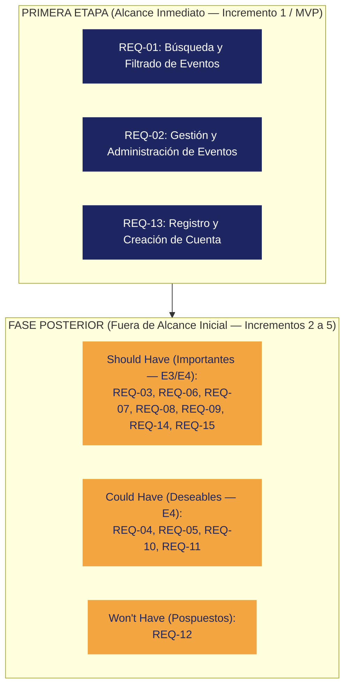

# Priorización de Requerimientos Funcionales (Metodología MoSCoW)

- **Proyecto:** Sistema de Eventos
- **Curso:** Ingeniería de Software I · 2026-II · Universidad Nacional de Colombia  
- **Marco Metodológico:** MoSCoW aplicado a capacidad limitada y desarrollo incremental (Clase 10)  

---

## 1. Delimitación de Alcance por Fases

Conforme a los lineamientos del proyecto de la asignatura, el equipo ha clasificado el catálogo completo de requerimientos funcionales (`REQ-01` a `REQ-15`). 

Para garantizar la construcción de un incremento funcional verticalmente integrado en la **Primera Etapa (Incremento 1 / E1-E2)**, el alcance inmediato se delimita de manera estricta a tres requerimientos principales:

---

## 2. Primera Etapa: Requerimientos Esenciales (Must Have)

Estos tres requerimientos representan el **núcleo mínimo viable** del sistema. Sin ellos, el programa no puede ser operado, no ofrece contenido ni satisface la necesidad elemental de descubrimiento de actividades (`NEED-01`, `NEED-08` y necesidad de identidad).

| ID | Nombre del Requerimiento | Descripción Breve | Justificación de Inclusión en Primera Etapa |
| :--- | :--- | :--- | :--- |
| **REQ-01** | **Búsqueda y filtrado de eventos** | Consultar y filtrar eventos por presupuesto máximo, rango de horario disponible y zona geográfica. | Es la funcionalidad central que resuelve el problema de los usuarios: encontrar actividades viables sin perder tiempo en opciones incompatibles. |
| **REQ-02** | **Gestión de eventos** | Permitir a los organizadores autorizados crear, modificar y eliminar eventos dentro de la plataforma. | Provee el contenido y la administración del catálogo de eventos local; sin gestión de eventos, el sistema carece de información que consultar. |
| **REQ-13** | **Registro y creación de cuenta** | Permitir a nuevos usuarios registrarse en la plataforma mediante credenciales seguras. | Establece la base de autenticación e identidad necesaria para autorizar la creación de eventos y gestionar la trazabilidad de usuarios. |

### Argumentación y Trade-Offs de la Primera Etapa
> **Decisión de priorización:** Priorizar `REQ-01`, `REQ-02` y `REQ-13` permite entregar un producto funcional de extremo a extremo (Frontend → API Gateway → Lógica de Dominio → Persistencia en Base de Datos). Aceptamos conscientemente el costo de posponer para iteraciones futuras las capacidades de recomendación automática (`REQ-03`), agendamiento externo (`REQ-07`), marcado social (`REQ-08`) y perfiles avanzados (`REQ-15`). Tratar todas las funciones como *Must Have* impediría validar la arquitectura y el modelo de dominio en los plazos fijados por la asignatura.

---

## 3. Fase Posterior: Requerimientos Fuera del Alcance Inicial

Los requerimientos restantes **no se eliminan del proyecto**, sino que se documentan y planifican para ser incorporados gradualmente en los siguientes incrementos (E3, E4 y E5), conforme evolucione el software y se consolide el núcleo transaccional.

### 3.1. Should Have (Debería tener — Fase Posterior / Incrementos E3 y E4)
Funcionalidades de alto valor para enriquecer la experiencia de usuario y afianzar la retención, programadas para la segunda fase del desarrollo.

| ID | Nombre | Descripción Breve | Estado en Proyecto |
| :--- | :--- | :--- | :--- |
| **REQ-03** | Recomendaciones por preferencias | Sugerir eventos automáticamente al usuario basándose en sus intereses guardados. | *Fase Posterior (E3)* |
| **REQ-06** | Fijado de eventos | Permitir a los usuarios fijar actividades de su interés para acceso rápido posterior. | *Fase Posterior (E3)* |
| **REQ-07** | Agendamiento de eventos | Agendar actividades en el calendario personal del usuario o agenda del sistema. | *Fase Posterior (E3)* |
| **REQ-08** | Marcado de asistencia | Marcar eventos a los que se planea asistir y consultar el itinerario personal. | *Fase Posterior (E3)* |
| **REQ-09** | Conteo público de asistentes | Mostrar la cantidad de personas interesadas o confirmadas en la ficha del evento. | *Fase Posterior (E4)* |
| **REQ-14** | Eventos destacados para invitados | Mostrar los eventos mejor valorados a personas que aún no inician sesión. | *Fase Posterior (E3)* |
| **REQ-15** | Gestión de preferencias de usuario | Seleccionar y actualizar las etiquetas de gustos y preferencias en el perfil. | *Fase Posterior (E3)* |

### 3.2. Could Have (Podría tener — Fase Posterior / Deseables para Incremento E4)
Funcionalidades complementarias de comunidad y valor social agregada que se implementarán si el esfuerzo y la velocidad del equipo lo permiten.

| ID | Nombre | Descripción Breve | Estado en Proyecto |
| :--- | :--- | :--- | :--- |
| **REQ-04** | Notificación de recomendaciones | Enviar alertas al usuario cuando se publiquen eventos afines a sus gustos. | *Fase Posterior (E4)* |
| **REQ-05** | Calificación de eventos y organizadores | Valorar la calidad del evento (1 a 5 estrellas) y la reputación del creador. | *Fase Posterior (E4)* |
| **REQ-10** | Recomendación entre usuarios | Permitir recomendar actividades de forma directa a otros contactos. | *Fase Posterior (E4)* |
| **REQ-11** | Gestión de lista de amigos | Agregar y administrar contactos de confianza dentro de la aplicación. | *Fase Posterior (E4)* |

### 3.3. Won't Have (No tendrá por ahora — Fuera de Alcance Inicial / Pospuestos)
Requerimientos que han sido formalmente descartados para la primera y segunda fase, evaluables únicamente para la entrega de cierre o evolución futura.

| ID | Nombre | Descripción Breve | Justificación |
| :--- | :--- | :--- | :--- |
| **REQ-12** | Notificación por alteración de eventos marcados | Notificar automáticamente a los asistentes ante modificaciones de horario, recinto o cancelación del evento. | Requiere un motor complejo de eventos asíncronos y despacho masivo de notificaciones que añade riesgo operativo innecesario en etapas tempranas. |

---

## 4. Matriz de Cumplimiento y Trazabilidad

| ID Requerimiento | Alcance Planificado | Justificación de Capacidad (Clase 10) |
| :---: | :---: | :--- |
| **REQ-01** | **Primera Etapa (Must Have)** | Demanda central evidenciada en NEED-01; base del primer incremento. |
| **REQ-02** | **Primera Etapa (Must Have)** | Provisión de contenido local indispensable para poblar el catálogo. |
| **REQ-13** | **Primera Etapa (Must Have)** | Base de seguridad, sesión y control de acceso del sistema. |
| **REQ-03 al REQ-11, REQ-14, REQ-15** | **Fase Posterior (Should/Could)** | Extensiones funcionales diferidas para evitar sobrecarga en el primer vertical slice. |
| **REQ-12** | **Fuera de Alcance Inicial (Won't)** | Dependencia de infraestructura de mensajería asíncrona postergada. |
