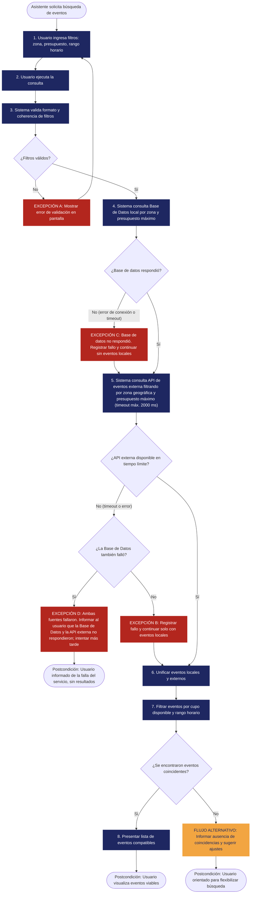

<!--

-->

# REQ-01 — Filtrado de eventos

| | |
|---|---|
| **Estado** | validado |
| **Equipo** | Cristian Andres Diaz Ortega - Juan Sebastian Rodriguez Carvajal - Martin Lora Caro - Justin David Vargas Vasquez -Nicolas David Lovera Cabiativa|
| **Fecha** |9/10/2026|
| **Historia de usuario relacionada** |US-01.1,US-01.2,US-01.3|

---

## 1. General

**Requerimiento**
> El sistema debe permitir al usuario consultar y filtrar eventos ingresando su presupuesto máximo, su rango de disponibilidad horaria y su zona geográfica (país, departamento/estado y ciudad).

**Tipo:** Funcional *(Sigue existiendo pasando por el filtro de la computadora perfecta: el usuario aun así necesita colocar los filtros para encontrar los eventos compatibles)* 

**Fuente / Evidencia**
> Documento de Necesidades del Usuario, `NEED-01` — Descubrimiento de eventos viables: *"El usuario necesita encontrar actividades acordes a su dinero disponible, tiempo libre y la ciudad/zona donde se ubica para evitar la frustración de consultar opciones a las que no puede asistir"*.

**Necesidad**
> Encontrar actividades y eventos compatibles con las restricciones personales de presupuesto, tiempo y ubicación geográfica del usuario. *(Formulada como meta del usuario, no como solución tecnológica).*

**Valor / Justificación**
> Reduce la incertidumbre y el costo de búsqueda manual del usuario al descartar automáticamente ofertas incompatibles, permitiéndole descubrir opciones viables y alcanzables en su entorno.

---

## 2. Contexto — Un requerimiento rara vez existe aislado

**Reglas de negocio**
> **BR-01 — Cupos disponibles mínimos:** Para eventos con aforo o boletería limitada, solo se mostrarán eventos que cuenten con al menos un (1) cupo o entrada disponible al momento de procesar la consulta. Los eventos agotados quedan excluidos del listado general.

> **BR-02 — Calificación tarifaria por presupuesto:** En eventos con múltiples tipos o localidades de entrada (ej. General $20.000 y VIP $50.000), el evento califica como resultado válido si al menos una de sus tarifas vigentes es menor o igual al presupuesto máximo indicado por el usuario.
 
> **BR-03 — Combinación flexible de filtros:** El usuario puede ingresar cualquier combinación de los tres criterios de búsqueda (presupuesto, horario, zona) o no ingresar ninguno. La consulta filtrará únicamente por los parámetros efectivamente provistos; si no se provee ningún filtro, el sistema presentará eventos sugeridos de forma aleatoria.

**Restricción(es)**
> 1. El sistema debe integrarse con proveedores de eventos externos mediante APIs REST de terceros, operando dentro de los límites de cuota (rate limits) y términos de servicio de dichos proveedores, sin asumir control sobre el ciclo de vida de los eventos remotos.  

> 2. Conforme a las directrices de la asignatura, el sistema central opera bajo un modelo de monolito modular con almacenamiento relacional embebido/local, requiriendo que la lógica de filtrado de eventos locales se ejecute en el mismo proceso de aplicación.

**Supuesto(s)**
> *(Condiciones externas asumidas como verdaderas que NO dependen del control del equipo de desarrollo, diferenciadas de acciones internas o requisitos funcionales):*

> 1. **Disponibilidad de catálogo en fuentes externas:** Se asume que las plataformas y APIs externas de eventos disponen de un volumen activo y continuo de eventos públicos vigentes en las regiones geográficas cubiertas por el sistema. 

> 2. **Veracidad y legitimidad de los datos publicados:** Se asume que la información provista por los organizadores y fuentes externas (precios, horarios, ubicaciones y vigencia) es fidedigna, legal y no engañosa al momento de su captura.  

> 3. **Estabilidad razonable en las interfaces de terceros:** Se asume que los servicios externos mantienen contratos de API estables con tiempos de respuesta compatibles con la interacción web (latencia inferior a 2-3 segundos en condiciones normales).

**Dependencia(s)**
> 1. Disponibilidad y conectividad de red con las APIs de proveedores externos de eventos.  

> 2. Disponibilidad de la Capa de Persistencia y Base de Datos local para la consulta y recuperación de los eventos administrados internamente en la plataforma.

**Riesgo(s)**

| Riesgo | Probabilidad | Impacto | Mitigación |
|---|---|---|---|
| **Publicación o ingesta de eventos falsos o fraudulentos** *(Caso corregido y enfatizado por el docente)*: Fuentes externas no verificadas u organizadores maliciosos listan eventos inexistentes, engañosos, cancelados o con fines de estafa (e.g. cobro de entradas falsas o suplantación de recintos). | Media | Alto (Pérdida severa de confianza del usuario, daño reputacional de la plataforma y posibles contingencias legales o de seguridad para los asistentes). | Señalizar visualmente eventos provenientes de fuentes de terceros como *"Información agregada externa — No verificada por la plataforma"*; habilitar mecanismo comunitario de reporte (*"Reportar evento sospechoso"*); limitar ingesta a APIs con reputación validada y suministrar enlaces directos a boleterías oficiales. |
| **Indisponibilidad, alta latencia o rate limiting de la API externa de eventos**: Caída del proveedor externo, tiempos de respuesta mayores a 3 segundos o agotamiento de cuotas de consumo por alta demanda. | Media | Alto (Degradación del catálogo en tiempo real; el usuario no puede acceder a eventos provistos por terceros). | Implementar patrón Adapter con Circuit Breaker y fallback: si la API externa no responde en un umbral estricto (2 segundos), la consulta responde inmediatamente con eventos locales y notifica al usuario que los eventos externos están temporalmente inaccesibles. |
| **Desfase o desactualización en horarios, precios y cupos de eventos**: Un evento agota entradas o altera su tarifa/horario en la plataforma de origen sin reflejarlo a tiempo en la API de consulta. | Media-Alta | Medio (Frustración del usuario al encontrar discrepancias entre los resultados filtrados y las condiciones reales del evento). | Desplegar sello temporal de *"Última sincronización"* en la ficha del evento y enlace directo al sitio oficial del evento para confirmación final. |
| **Modificaciones imprevistas en los esquemas de datos del proveedor**: Cambios intempestivos en el formato JSON, tipos de datos o campos de la API externa que rompen la deserialización. | Media-Baja | Medio-Alto (Falla en el parseo y filtrado de eventos externos, causando omisión de resultados válidos). | Aislamiento estricto de la integración en un módulo adaptador desacoplado; validación de esquema en la ingesta descartando de forma segura registros mal formados sin afectar el resto de la consulta. |

**Preguntas abiertas (Open Questions)**
> 1. ¿Cómo debe tratar el algoritmo de solapamiento horario a los eventos de tipo "vida nocturna" que inician un día y finalizan en la madrugada del día siguiente, si el usuario define un rango horario nocturno (ej. 20:00 a 02:00)? *(Pendiente de validación en diseño detallado de la regla de horario).*  
> 2. ¿Cuál será la política de reintentos cuando una API externa responda con error 429 (Too Many Requests)??

---

## 3. Prioridad y Estimación

**Modelo de priorización utilizado:** MoSCoW  
*(Elegido de acuerdo con la comparación de la Clase 10 para delimitar el núcleo esencial del MVP con recursos limitados).*

**Prioridad asignada:** **Must Have (Imprescindible)**
> **Justificación de la decisión:**  
> Porque la consulta y filtrado de eventos por presupuesto, horario y ubicación geográfica constituye la propuesta de valor nuclear del sistema (descubrimiento viable según Need-01 y US-01.1/2/3). Sin esta funcionalidad, la plataforma pierde su razón de ser y no resuelve el problema identificado. Aceptamos el costo de postergar funcionalidades deseables o secundarias (como filtros avanzados por categoría, fijado de eventos, calificaciones o vistas en mapa interactivo) para fases posteriores. Consideramos la clasificación *Should have* y la rechazamos porque entregar el primer incremento sin esta capacidad básica haría inviable e incompleta la experiencia de usuario.

**Estimación (confianza):** Media
> **Justificación de la confianza:**  
> La lógica de consulta y filtrado por presupuesto y zona geográfica es directa y bien comprendida (consultas relacionales indexadas estándar). La incertidumbre que reduce la confianza a *Media* radica en la lógica de evaluación temporal de disponibilidad horaria (manejo de rangos, recurrencias periódicas y eventos multijornada) y en la variabilidad en los tiempos de respuesta de la API externa de eventos bajo condiciones de tráfico real.

---

## 4. Representaciones — El Requerimiento ≠ La Representación

*(Directrices de Clase 9: cada representación aporta una perspectiva complementaria; las tres son obligatorias).*

### 4.1 Historia de Usuario

> Como **asistente a eventos**,  
> quiero **filtrar eventos ingresando mi presupuesto máximo, rango de horario disponible y zona geográfica**,  
> para **encontrar actividades viables a las que realmente pueda y tenga la posibilidad de asistir**.

*Verificación de necesidad vs. solución:* El enunciado expresa la capacidad y el valor buscado por el rol de usuario, sin imponer tecnologías ni soluciones de interfaz prematuras.

### 4.2 Criterios de Aceptación

**Escenario 1 — Filtros combinados con coincidencias (Camino normal)**
> **Dado** que el usuario se encuentra en la pantalla de búsqueda de actividades y existen eventos vigentes registrados en "Colombia", departamento "Bogotá D.C.", ciudad "Bogotá",  
> **cuando** ingresa como presupuesto máximo "$50.000 COP", selecciona la ciudad "Bogotá" y define un rango horario de "hoy a las 18:00 a 22:00",  
> **entonces** el sistema retorna y despliega la lista de eventos cuya ubicación coincida con "Bogotá", cuya tarifa mínima vigente sea menor o igual a $50.000 COP (conforme a BR-02), cuyo horario esté comprendido en el rango indicado y que tengan al menos 1 cupo disponible (conforme a BR-01).

**Escenario 2 — Búsqueda sin coincidencias compatibles (Camino alternativo)**
> **Dado** que no existen eventos registrados en la ciudad "Medellín" con precio menor a "$10.000 COP" en el rango de "hoy a las 08:00 a 12:00",  
> **cuando** el usuario ejecuta la consulta con dichos filtros,  
> **entonces** el sistema informa claramente que no se encontraron eventos que satisfagan todos los criterios simultáneamente.

**Escenario 3 — Búsqueda de eventos de acceso libre / gratuitos**
> **Dado** que existen eventos vigentes de entrada libre ($0 COP) en la ciudad seleccionada dentro del rango horario del usuario,  
> **cuando** el usuario ejecuta la búsqueda ingresando un presupuesto máximo de "$0 COP",  
> **entonces** el sistema presenta exclusivamente los eventos gratuitos ($0 COP) que coincidan con la ubicación y el horario definidos.

**Escenario 4 — Búsqueda con filtros parciales**
> **Dado** que existen 15 eventos vigentes registrados para la ciudad de "Cali",  
> **cuando** el usuario selecciona únicamente la ciudad "Cali" dejando vacíos los campos de presupuesto y rango de horario,  
> **entonces** el sistema aplica la regla BR-03 y retorna los 15 eventos correspondientes a dicha ciudad.

**Escenario 5 — Búsqueda sin filtros (Consulta abierta)**
> **Dado** que el catálogo contiene eventos vigentes y el usuario no especifica ningún criterio de filtrado,  
> **cuando** el usuario solicita ver actividades disponibles,  
> **entonces** el sistema aplica BR-03 y presenta un listado  de eventos vigentes aleatorios.

---

### 4.3 Caso de Uso

| Campo | Descripción |
|---|---|
| **Nombre del Caso de Uso** | Consultar y Filtrar Eventos |
| **Actor** | Asistente a eventos (Usuario registrado o invitado) |
| **Meta** | Obtener un listado de eventos vigentes que se ajusten a su presupuesto, disponibilidad de tiempo y ubicación |
| **Disparador (Trigger)** | El usuario ingresa criterios de búsqueda y solicita la ejecución de la consulta |
| **Precondición** | El sistema se encuentra operativo y el servicio de eventos dispone de registros locales o remotos |

**Flujo Principal**
1. El usuario accede a la sección de búsqueda e ingresa de forma opcional: zona geográfica, presupuesto máximo disponible y rango horario (hora de inicio y hora de fin).
2. El usuario envía la solicitud de búsqueda.
3. El sistema valida el formato y la coherencia de los criterios ingresados (presupuesto positivo, hora de fin posterior a la hora de inicio).
4. El sistema consulta la base de datos local filtrando por zona geográfica y presupuesto máximo.
5. El sistema consulta la API de eventos externa filtrando por zona geográfica y presupuesto máximo a través del componente de integración, con un tiempo límite de 2 segundos.
6. El sistema unifica los eventos locales y externos en un solo listado.
7. El sistema aplica las reglas de negocio (BR-01 de cupos disponibles y BR-02 de tarifas menores o iguales al presupuesto), filtra por el rango horario cuando el usuario lo indicó y excluye los eventos vencidos.
8. El sistema presenta al usuario la lista ordenada de eventos compatibles con sus restricciones y, si alguna fuente no respondió, un aviso de que los resultados pueden estar incompletos.

**Flujo Alternativo**
> **Sin eventos coincidentes (Paso 7):** Si ningún evento cumple la combinación de filtros, el sistema informa que no hay coincidencias, mantiene los filtros en pantalla y sugiere ampliar el rango horario o aumentar el presupuesto (Escenario 2). Si además alguna fuente no respondió, el sistema aclara que algunos eventos no pudieron consultarse.

**Excepciones**
> **Excepción A — Criterios de entrada malformados (Paso 3):** Si el usuario ingresa valores no válidos (por ejemplo, un presupuesto negativo o una hora de fin anterior a la hora de inicio), el sistema detiene la consulta, señala visualmente el campo con error y solicita la corrección, conservando los demás datos ingresados.  
> **Excepción B — Falla o timeout de la API externa de eventos (Paso 5):** Si el servicio de eventos externos no responde en 2 segundos o devuelve un error HTTP, y la base de datos local sí respondió, el sistema marca la fuente externa como no disponible y continúa solo con los eventos locales. Al presentar los resultados, muestra un aviso de que los eventos externos no pudieron cargarse por el momento.  
> **Excepción C — La base de datos local no respondió (Paso 4):** Si la base de datos local presenta un error de conexión o de tiempo de espera, el sistema marca la fuente local como no disponible y continúa con la consulta a la API externa (Paso 5). Al presentar los resultados, muestra un aviso de que los eventos del catálogo propio no pudieron cargarse por el momento.  
> **Excepción D — Ambas fuentes fallaron (Paso 5):** Si la base de datos local no respondió (Excepción C) y la API externa tampoco, el sistema detiene la consulta e informa al usuario que el servicio de búsqueda no está disponible por el momento y que intente más tarde. No muestra el mensaje de "sin coincidencias", porque la falta de resultados se debe al sistema y no a los filtros.

**Postcondición**
> El usuario ve los eventos viables para su búsqueda, recibe orientación clara para ajustar sus criterios o es informado de que el servicio no está disponible temporalmente. En todos los casos sabe si los resultados están completos y el sistema no se bloquea.

**Diagrama de Flujo del Caso de Uso**

---

## 5. Trazabilidad e Impacto

*(Directrices de Clase 10: Trazabilidad conceptual bidireccional y análisis de impacto).*

**Antecedente (Backward) — ¿Por qué existe este requerimiento?**
> Evidencia en fase de descubrimiento (`NEED-01`) → Necesidad: *"Descubrimiento de eventos viables"* → Historias de Usuario (`US-01.1`, `US-01.2`, `US-01.3`) → **REQ-01**.

**Efecto (Forward) — ¿Qué elementos del sistema impacta?**
> **REQ-01** → **Diseño Arquitectónico:** Define componentes `Aplicación Web` (vistas de búsqueda), `API Gateway` (enrutamiento de consulta), `Gestión de Eventos` (`ConsultadorEventos`), `Integración de Eventos Externos` (`IProveedorEventosExternos`), y `Capa de Persistencia` (`IRepositorioDeEventos`) → **Implementación:** Módulos de filtrado y adapters → **Pruebas:** Casos de prueba automatizados basados en criterios `AC-01.1` a `AC-01.5`.

**Análisis de impacto**
- [ ] Reglas de negocio 
- [x] Restricción(es)
- [x] Dependencias
- [x] Riesgos
- [x] Criterios de aceptación
- [x] Estimación (confianza)
- [ ] Prioridad 
- [x] Diseño futuro
- [x] Futuras pruebas

> Si cambia un proveedor de eventos, las Restricciones, Dependencias, Riesgos, y el Diseño y las Pruebas futuras necesitarían revisión — la integración, los contratos de datos y los escenarios de fallo dependen directamente de ese proveedor. Las Reglas de Negocio y la Prioridad no se cambia: BR-01, BR-02 y BR-03 son reglas de dominio, y la Prioridad depende de la necesidad del usuario (Need-01), no de los detalles técnicos de implementación. Por eso quedan sin marcar.

---

## 6. Validación

- [x] **Válido?** Si, sale directamente de Need-01 y US-01.x.
- [x] **Claro?** Si, "consultar y filtrar eventos por presupuesto máximo, rango de disponibilidad horaria y zona geográfica" tiene una lectura razonable única para eventos.
- [x] **Atómico?** Si, es una única expectativa verificable de forma independiente (filtrar y listar eventos), no varias capacidades distintas empaquetadas juntas.
- [x] **Necesario?** Si, removerlo elimina la funcionalidad central de descubrimiento del MVP, la cual responde directamente al Need-01.
- [x] **Alcanzable?** Si, filtros por presupuesto y zona geográfica son consultas estándar; el filtro por horario es alcanzable aunque con mayor costo por eventos multi-día, zonas horarias y solapamientos parciales.
- [x] **Verificable?** Si, AC-01.1 a AC-01.5 dan condiciones de paso/fallo observables y concretas.
- [x] **Consistente?** Si, no se identificó conflicto con otras reglas del mismo conjunto; BR-01 y BR-02 son coherentes con los criterios de aceptación.
- [x] **Completo?** Si, Se define los filtros que se van a usar y cómo se comporta esta parte del sistema
- [x] **trazable?** Sí, cada sección anterior remite a evidencia real.
      
      
