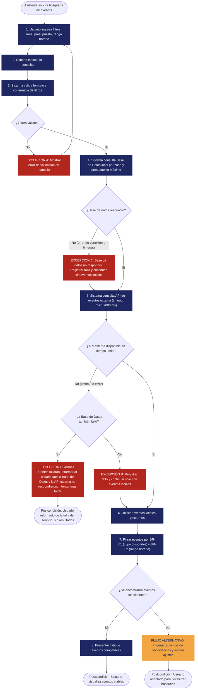
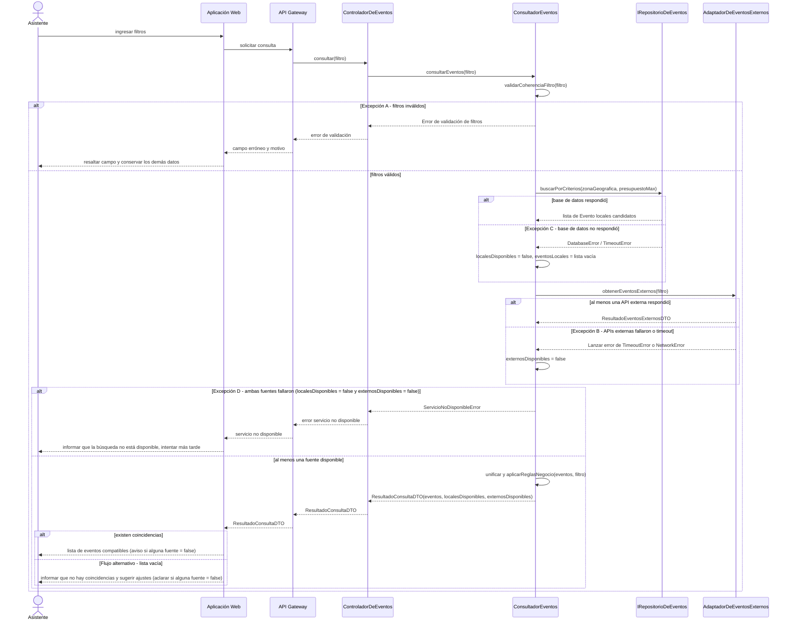

```text
consultarEventos(filtro):
    TRY:
        validarCoherenciaFiltro(filtro)
    EXCEPTION (invalidField):
        throw(invalidField) // EXCEPCIÓN A: precios negativos o fechas incoherentes

    localesDisponibles = VERDADERO
    externosDisponibles = VERDADERO

    TRY:
        eventosLocales = repositorio.buscarPorCriterios(filtro.zonaGeografica, filtro.presupuestoMaximo)
    EXCEPTION (DatabaseError, TimeoutError):
        localesDisponibles = FALSO // EXCEPCIÓN C
        eventosLocales = LISTA_VACIA

    TRY:
        respuestaExterna = IProveedorEventosExternos.obtenerEventosExternos(filtro) // timeout max 2000 ms
        eventosExternos = respuestaExterna.eventosValidados
    EXCEPTION (TimeoutError, NetworkError):
        IF NO localesDisponibles:
            throw ServicioNoDisponibleError("Base de datos y API externa no respondieron") // EXCEPCIÓN D
        externosDisponibles = FALSO // EXCEPCIÓN B
        eventosExternos = LISTA_VACIA

    eventosConsolidados = unificar(eventosLocales, eventosExternos)

    listaFinal = []
    FOR evento IN eventosConsolidados:
        IF evento.tieneCupoDisponible():
            IF filtro.rangoHorario ES NULO O evento.horario.coincideConRango(filtro.rangoHorario):
                listaFinal.agregar(mapearADTO(evento))

    RETURN ResultadoConsultaDTO(
        eventos = listaFinal,                  // vacía → Flujo Alternativo
        localesDisponibles = localesDisponibles,
        externosDisponibles = externosDisponibles
    )
```


| Use Case step or flow | Message(s) in the diagram | Information exchanged | Operation defined in (Deliverable 1) |
|---|---|---|---|
| Flujo principal, pasos 1–2 (ingresar y enviar filtros) | `ingresar filtros`, `solicitar consulta`, `consultar`, `consultarEventos` | País, departamento, ciudad, presupuesto máximo, rango horario (todos opcionales) | `ControladorDeEventos.consultar(filtro)`, `ConsultadorEventos.consultarEventos(filtro)` |
| Flujo principal, paso 3 (validar formato y coherencia) | `validarCoherenciaFiltro` | `FiltroEventosDTO` | `ConsultadorEventos.validarCoherenciaFiltro(filtro)` |
| Flujo principal, paso 4 (consultar BD local) | `buscarPorCriterios`, `lista de Evento locales candidatos` | `zonaGeografica`, `presupuestoMax` → lista de `Evento` | `IRepositorioDeEventos.buscarPorCriterios(zonaGeografica, presupuestoMax)` |
| Flujo principal, paso 5 (consultar APIs de eventos externas) | `obtenerEventosExternos`, `ResultadoEventosExternosDTO` | Filtro → `ResultadoEventosExternosDTO` | `IProveedorEventosExternos.obtenerEventosExternos(filtro)` implementado por `AdaptadorDeEventosExternos`|
| Flujo principal, pasos 6–7  | `unificar y aplicarReglasNegocio` | Lista unificada de `Evento` que cumple los filtros dados | `ConsultadorEventos.aplicarReglasNegocio(eventos, filtro)` |
| Flujo principal, paso 8 (presentar resultados) | `ResultadoConsultaDTO`, `lista de eventos compatibles` | `ResultadoConsultaDTO(eventos, localesDisponibles, externosDisponibles)` | `ControladorDeEventos.consultar` devuelve `ResultadoConsultaDTO` |
| Flujo alternativo (sin coincidencias, paso 7) | `informar que no hay coincidencias y sugerir ajustes` | `ResultadoConsultaDTO` con lista vacía, `localesDisponibles`, `externosDisponibles` | `ControladorDeEventos.consultar` devuelve `ResultadoConsultaDTO` |
| Excepción A (criterios malformados, paso 3) | `Excepción A`, `Error de validación de filtros` | Campo erróneo y motivo | `ConsultadorEventos.validarCoherenciaFiltro(filtro)` lanza `ErrorValidacion` |
| Excepción B (timeout o falla de las APIs externas, paso 5) | `Excepción B`, `TimeoutError / NetworkError` | Error capturado → `eventosExternos` = lista vacía, `externosDisponibles = false` | `AdaptadorDeEventosExternos.obtenerEventosExternos` lanza el error (timeout 2 s); `ConsultadorEventos.consultarEventos` lo captura y continúa con eventos locales |
| Excepción C (base de datos no respondió, paso 4) | `Excepción C`, `DatabaseError / TimeoutError` | Error capturado → `eventosLocales` = lista vacía, `localesDisponibles = false` | `IRepositorioDeEventos.buscarPorCriterios` lanza el error; `ConsultadorEventos.consultarEventos` lo captura y continúa con la consulta externa |
| Excepción D (ambas fuentes fallaron, paso 5) | `Excepción D`, `ServicioNoDisponibleError`, `servicio no disponible` | `localesDisponibles = false` y error externo →  mensaje de servicio no disponible | `ConsultadorEventos.consultarEventos` lanza `ServicioNoDisponibleError` |
